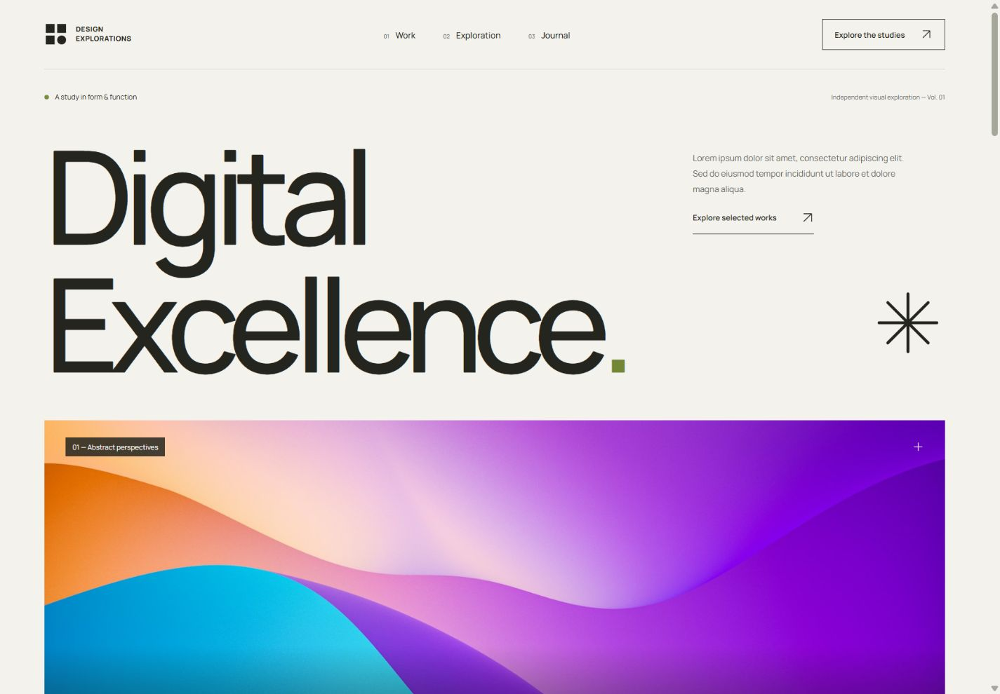

# Digital Excellence

Landing page anônima de exploração visual, desenvolvida com **React, JavaScript (JSX), Vite e CSS puro**. A interface reúne um hero tipográfico, uma galeria assimétrica de estudos, uma composição geométrica, uma seção editorial e um rodapé minimalista.

A referência de composição e experiência é [grigoletti.ch/en](https://grigoletti.ch/en/). Este projeto é uma interpretação original: não reproduz a identidade, os textos, os trabalhos ou os dados pessoais da referência. Os estudos são ilustrativos, e os parágrafos da página usam Lorem Ipsum.



## Requisitos

- Node.js **20.19+ ou 22.12+**, conforme a exigência do Vite 7; versões posteriores compatíveis também podem ser utilizadas.
- npm, incluído na instalação do Node.js.
- Navegador moderno com suporte a `<dialog>` e Intersection Observer.

## Instalar

No PowerShell:

```powershell
git clone --branch funcionalidade/pagina-inicial-react https://github.com/ArthurSgarbi/CP6-Web-Dev.git
cd CP6-Web-Dev
npm install
```

Se você baixou o ZIP, extraia os arquivos e abra a pasta que contém `package.json` antes de executar `npm install`.

## Executar localmente

```powershell
npm run dev
```

Abra o endereço exibido pelo Vite no terminal, normalmente `http://127.0.0.1:5173`. O servidor utiliza somente a interface local do computador. Alterações nos arquivos são refletidas durante o desenvolvimento.

## Gerar o build

```powershell
npm run build
```

O resultado é criado em `dist/`, com HTML, JavaScript, CSS, imagens e fonte. Essa pasta pode ser servida por uma hospedagem estática. Não é necessário configurar variáveis de ambiente para esta interface.

Para conferir o build localmente:

```powershell
npm run preview
```

Abra o endereço exibido no terminal, normalmente `http://127.0.0.1:4173`. O comando de preview serve para inspeção local do build.

## Organização

```text
CP6-Web-Dev/
├── docs/
│   ├── preview-desktop.png
│   ├── preview-mobile.png
│   └── VERIFICATION.md
├── public/
│   ├── favicon.svg
│   ├── fonts/
│   │   ├── manrope-latin.woff2
│   │   └── OFL-Manrope.txt
│   └── images/
│       ├── hero-abstract.jpg
│       ├── study-architecture.jpg
│       ├── study-form.jpg
│       ├── study-space.jpg
│       └── study-color.jpg
├── src/
│   ├── components/
│   │   ├── Exploration.jsx
│   │   ├── Footer.jsx
│   │   ├── Header.jsx
│   │   ├── Hero.jsx
│   │   ├── Icon.jsx
│   │   ├── Journal.jsx
│   │   ├── SectionLabel.jsx
│   │   ├── SelectedWorks.jsx
│   │   ├── StudyDialog.jsx
│   │   └── TextLink.jsx
│   ├── data/
│   │   └── studies.js
│   ├── hooks/
│   │   ├── useAnchorNavigation.js
│   │   └── useReveal.js
│   ├── App.jsx
│   ├── main.jsx
│   └── styles.css
├── .gitignore
├── ASSETS.md
├── index.html
├── package.json
├── package-lock.json
├── README.md
└── vite.config.js
```

O npm gera `package-lock.json` ao instalar as dependências. `node_modules/` contém os pacotes instalados e é ignorada pelo Git; `dist/` contém a saída do build e também é ignorada.

## Decisões de interface

- **Composição:** linguagem editorial inspirada no Design Suíço Moderno, com alinhamentos precisos, bastante espaço vazio, linhas finas e alternância entre imagens amplas e blocos menores. A galeria evita uma sequência uniforme de cartões.
- **Tipografia:** Manrope variável, servida localmente, com títulos expressivos, espaçamento compacto nas letras e hierarquia entre títulos, corpo e legendas.
- **Cor:** base clara e contraste escuro, com detalhes de verde e a cor concentrada nas imagens abstratas. A seção de exploração altera o ritmo visual da página.
- **Responsividade:** dimensões fluidas e mudanças na grade para reorganizar o conteúdo em celular, tablet e desktop. A navegação compacta entra nas larguras de até 800 px.
- **Dependências:** React para componentes, estado e eventos; Vite para desenvolvimento e build. Ícones vetoriais e animações são implementados no próprio projeto, sem bibliotecas adicionais de interface ou movimento.

## Componentes e comportamento

`App.jsx` organiza as seções e mantém o estudo selecionado. Os arquivos `Hero.jsx`, `SelectedWorks.jsx`, `Exploration.jsx`, `Journal.jsx`, `Footer.jsx`, `SectionLabel.jsx` e `TextLink.jsx` separam responsabilidades de apresentação e evitam repetir elementos equivalentes. O componente `Study` permanece interno a `SelectedWorks.jsx`, onde é utilizado pela galeria.

- `Header.jsx` controla o menu mobile com estado do React, atualiza `aria-expanded`, fecha após selecionar uma seção, com Escape ou ao clicar fora e acompanha o indicador da seção atual.
- `StudyDialog.jsx` usa o elemento nativo `<dialog>`. Permite abrir cada estudo, navegar pelos botões anterior/próximo ou pelas setas do teclado e fechar pelo botão, Escape ou clique no fundo. Ao fechar, devolve o foco ao elemento que abriu o estudo.
- `Icon.jsx` centraliza os SVGs reutilizáveis; ícones decorativos ficam fora da leitura assistiva.
- `studies.js` concentra título, categoria, imagem, texto alternativo e Lorem Ipsum de cada estudo ilustrativo.
- `useAnchorNavigation.js` controla a rolagem por âncoras, move o foco para o destino e mantém a URL correspondente. Um Intersection Observer acompanha a seção visível para atualizar a navegação.
- `useReveal.js` usa Intersection Observer para revelar elementos durante a rolagem. O conteúdo começa visível; a animação é aplicada somente aos elementos fora da tela e é dispensada quando há preferência por movimento reduzido.
- A seção editorial é um accordion controlado pelo React, com botões semânticos e relações `aria-expanded`/`aria-controls`.

O CSS fornece foco visível, estados de hover e regras para `prefers-reduced-motion`. Há um link para pular diretamente ao conteúdo principal. A navegação e os controles utilizam links e botões nativos para permitir operação por teclado.

## Escopo e recursos

Esta entrega contém somente o frontend da experiência visual. Não há cadastro, autenticação, API de projetos, formulário de contato ou persistência. Nenhum nome, retrato, biografia, cliente, depoimento, resultado ou contato pessoal foi inserido.

As cinco imagens públicas do Unsplash e a fonte Manrope estão incluídas localmente. A lista de origens, dimensões e informações de licença está em [ASSETS.md](./ASSETS.md). A licença SIL Open Font da Manrope está em `public/fonts/OFL-Manrope.txt`. Os recursos não dependem de requisições ao Unsplash ou ao Google Fonts durante o uso da página.

## Validação realizada

O build de produção foi gerado e conferido no navegador. O relatório com os fluxos verificados, tamanhos de tela, evidências e limites da inspeção está em [docs/VERIFICATION.md](./docs/VERIFICATION.md). As capturas desktop e mobile estão na mesma pasta.

## Verificação manual

Checklist para executar após iniciar o servidor. Os itens abaixo descrevem verificações; não representam resultados de testes já realizados.

- [ ] Conferir o layout em celular, tablet e desktop, incluindo uma largura de 320 px, sem rolagem horizontal inesperada.
- [ ] Abrir o menu mobile; seguir cada âncora; verificar o fechamento com Escape e clique fora.
- [ ] Percorrer os links e botões com Tab e Shift+Tab, conferindo o foco visível e a ausência de controles ocultos na sequência.
- [ ] Usar o link “Skip to content” e conferir o foco no conteúdo principal.
- [ ] Abrir todos os estudos; conferir imagem, título e texto; navegar com os botões e setas do teclado.
- [ ] Fechar o estudo com o botão, Escape e clique no fundo; conferir o retorno do foco ao botão de origem.
- [ ] Expandir e recolher os itens editoriais com mouse e teclado.
- [ ] Navegar pelas âncoras e testar voltar/avançar no navegador.
- [ ] Ativar a preferência de movimento reduzido e conferir a leitura do conteúdo sem as animações de entrada.
- [ ] Conferir as imagens, os textos alternativos e a indicação de que os estudos são ilustrativos.
- [ ] Gerar o build, executá-lo com `npm run preview` e conferir o console do navegador.
