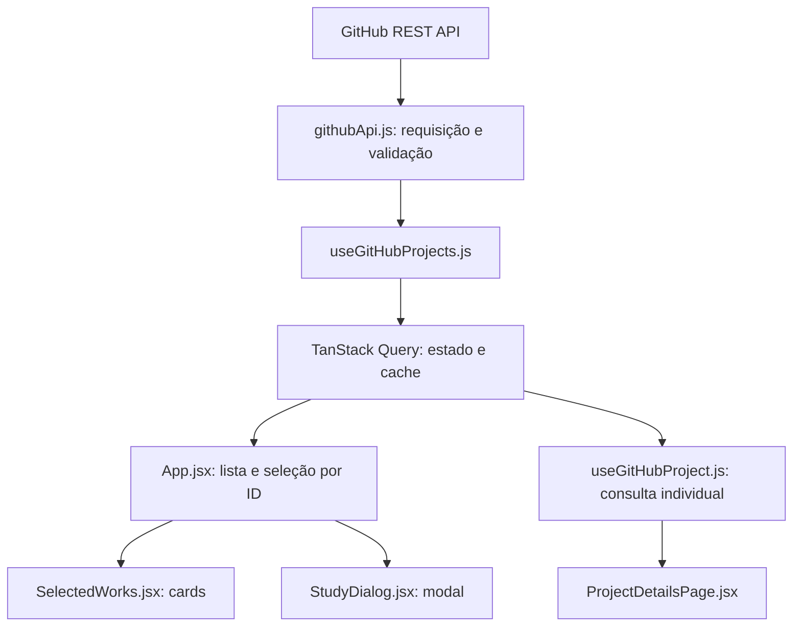

# Digital Excellence — portfólio React

Portfólio em **React 19, Vite 7, JavaScript/JSX e CSS puro**. A seção Projetos carrega repositórios públicos reais do GitHub, sem cadastro manual, preservando a composição editorial assimétrica, o fundo escuro e os detalhes verdes. O restante da landing page mantém seu conteúdo anterior.

## Executar

Requisitos: Node.js **20.19+ ou 22.12+** e npm. Navegador moderno com suporte a `<dialog>` e Intersection Observer.

```powershell
npm ci
Copy-Item .env.example .env
npm run dev
```

Copie o exemplo somente se ainda não tiver um `.env`. O arquivo contém:

```env
VITE_GITHUB_USERNAME=ArthurSgarbi
```

O endereço padrão é `http://127.0.0.1:5173/`. Reinicie o Vite depois de mudar a variável. Ela é pública, incluída durante o build; configure-a também no ambiente de build da Vercel. Sem ela, o desenvolvimento apresenta uma mensagem explicando como configurar a integração.

`.env`, `.env.*`, `node_modules/` e `dist/` continuam ignorados pelo Git; `.env.example` é a exceção versionável. Não há credenciais no exemplo.

## API e dados reais

Listagem principal:

```http
GET https://api.github.com/users/${username}/repos?type=owner&sort=updated&direction=desc&per_page=100
```

Detalhes para acesso direto sem cache:

```http
GET https://api.github.com/repos/${username}/${repositoryName}
```

O service segue a paginação indicada pelo header `Link`, acrescentando `page=2`, `page=3` etc. Só entrega a lista depois que todas as páginas forem validadas; uma falha em qualquer página gera erro explícito, sem publicar uma lista parcial.

Cada projeto utiliza `id`, `name`, `description`, `language`, `html_url`, `homepage`, `updated_at`, `stargazers_count`, `topics`, `fork` e `archived`. A interface exibe nome, descrição, linguagem, data, estrelas, tópicos e links. O ID identifica o item no React e na seleção do modal; o nome gera o slug; forks e arquivados são excluídos da listagem. Por escolha do proprietário, a seção exibe somente `meu-caixa`, `site-projeto-shopee`, `anninha-site-novo` e `ArthurSgarbi`, definidos em `formatRepository.js`. Essa seleção controla a visibilidade; os dados continuam vindo automaticamente da API. O número visual é calculado pela posição atual.

Campos ausentes usam “Descrição ainda não informada no GitHub” e “Tecnologia não informada”. O botão “Acessar projeto” aparece apenas para homepage válida em HTTP/HTTPS. Um domínio sem protocolo recebe HTTPS; protocolos inseguros e URLs com credenciais não viram links. Datas são apresentadas em pt-BR/UTC para evitar mudar o dia pela conversão de fuso.

A API foi escolhida porque os repositórios públicos já representam a fonte dos projetos: publicar ou atualizar um repositório elegível atualiza o portfólio na próxima consulta após a expiração do cache.

## Fluxo e separação de responsabilidades



- `githubApi.js` verifica `response.ok`, valida os campos, pagina, limita cada requisição a 15 segundos e lança `GitHubApiError` com códigos compreensíveis.
- `formatRepository.js` adapta dados reais à interface, aplica os fallbacks e filtra a lista. `formatDate.js` centraliza datas.
- `useGitHubProjects.js` centraliza a consulta da listagem. `useGitHubProject.js` reutiliza os dados brutos da mesma lista como dados iniciais de uma consulta individual.
- `App.jsx` seleciona pelo ID, calcula anterior/próximo na lista atual e fecha o modal se o item desaparecer após atualização.
- `HomePage.jsx` reúne as seções existentes. Os componentes de apresentação não fazem `fetch`.
- `ProjectInfo.jsx` compartilha informações e links entre modal e página individual; `ProjectImage.jsx` concentra o fallback de imagens.

### TanStack Query e estratégia de cache

Um único `QueryClient` fica fora da árvore React e é fornecido em `main.jsx`, junto ao `BrowserRouter`.

- Chaves estáveis por proprietário e nome, normalizados para minúsculas.
- `staleTime`: **10 minutos**; dados ainda recentes são reutilizados.
- `gcTime`: **30 minutos** após a consulta ficar sem observadores. Cache apenas em memória; recarregar o navegador inicia um novo cache.
- Sem consulta periódica ou refetch ao focar a janela. Trocar de seção e abrir o modal não dispara chamadas.
- Remontar ou reconectar pode atualizar dados vencidos. Uma consulta na rota individual usa o horário original do cache da listagem, preservando sua validade.
- No máximo **uma tentativa automática extra**, somente para falha de rede, timeout ou HTTP 5xx. 403/404, limite, configuração e resposta inválida não têm repetição automática.
- O service administra seu próprio timeout. A consulta não consome o sinal de cancelamento do TanStack, permitindo compartilhar a requisição em andamento durante a remontagem do StrictMode.
- Nova tentativa manual com `refetch()`. Dados já disponíveis continuam visíveis se uma atualização falhar.

## Estados da interface

| Estado | Comportamento |
| --- | --- |
| Carregamento | Quatro skeletons com a geometria da grade, fundo escuro, dimensões reservadas e anúncio por `role=status` |
| Sucesso | Cards dos quatro repositórios selecionados, quando originais e não arquivados, ordenados por atualização |
| Lista vazia | “Nenhum projeto público foi encontrado.”, inclusive quando todos os resultados forem filtrados |
| Erro | Mensagem amigável com “Tentar novamente”; falhas técnicas não são exibidas diretamente ao visitante |
| Limite da API | Mensagem específica pedindo para aguardar; sem repetição automática |
| Repositório inexistente | Página 404 própria, distinta da indisponibilidade da API |

403 por limite é identificado por `x-ratelimit-remaining: 0`, `retry-after` ou indicação no corpo; 429 também representa limite. Outros 403 representam acesso indisponível. 404 diferencia perfil ausente na listagem e repositório ausente no detalhe. Respostas inesperadas ou incompletas falham explicitamente.

### Limites e ausência de token

Requisições públicas sem autenticação têm um limite primário de **60 por hora por IP**; limites secundários também podem ocorrer. Cada página consultada conta como uma requisição. O cache reduz o consumo, mas não elimina a dependência do GitHub.

O frontend envia somente `Accept: application/vnd.github+json`, com `credentials: 'omit'`. Não utiliza header de autorização. **Não crie `VITE_GITHUB_TOKEN`**: variáveis com prefixo VITE são expostas ao navegador. Se futuramente for necessário autenticar, o token deve ficar numa função de backend com controle próprio de uso.

## Modal, rotas e acessibilidade

- Clique na imagem/botão abre os detalhes no `<dialog>` nativo.
- Nome e link “Página do projeto” navegam para `/projetos/:repositoryName`.
- O modal mantém fechamento por Escape, botão e clique no fundo; foco inicial no botão fechar; retorno ao acionador; Tab/Shift+Tab incluindo links externos; anterior/próximo e setas do teclado.
- Ao desaparecer o acionador após uma atualização, o foco retorna à seção Projetos.
- Links externos usam `target="_blank"` e `rel="noopener noreferrer"`.
- Títulos semânticos, foco visível, anúncios de estado, textos alternativos e `prefers-reduced-motion` foram mantidos.
- A navegação por âncoras usa o histórico do Router; as animações também observam os cards carregados de forma assíncrona.

Abrir ou atualizar uma URL individual funciona sem cache: apenas o endpoint de detalhes é consultado. A listagem fica desabilitada nessa rota. Se o repositório já estiver no cache recente da lista, nenhuma consulta extra é necessária. As páginas de detalhes e 404 têm carregamento de código sob demanda.

Na Vercel, `vercel.json` verifica primeiro o filesystem e depois encaminha rotas da SPA a `index.html`. Arquivos existentes, como imagens, fontes e assets do build, continuam sendo servidos diretamente. O erro 404 de uma rota desconhecida é apresentado pelo React; por ser uma SPA estática, a hospedagem pode responder HTTP 200 ao entregar o HTML.

## Imagens por convenção

Adicione um PNG com **o nome exato do repositório**:

```text
Repositório: sistema-de-gastos
Arquivo: public/images/sistema-de-gastos.png
URL: /images/sistema-de-gastos.png
```

Considere maiúsculas/minúsculas, especialmente no deploy Linux. As imagens apenas apresentam o projeto; seus metadados vêm do GitHub.

Se a imagem não carregar, `ProjectImage` troca uma única vez para `/images/hero-abstract.jpg`, sem loop de `onError`. O texto alternativo identifica a composição de fallback. Todas as imagens dos projetos mantêm lazy loading e dimensões explícitas; o CSS reserva sua proporção antes do carregamento.

As imagens existentes no hero permanecem como apresentação anterior da landing page. Não determinam quais projetos são carregados da API. Origens dos assets e licenças: [ASSETS.md](ASSETS.md).

## Testar e gerar o build

```powershell
npm test
npm run test:watch
npm run build
npm run preview
```

`npm test` executa a suíte uma vez; `test:watch` acompanha alterações. Os testes usam **Vitest, React Testing Library, user-event, jest-dom e jsdom**, simulando `fetch`. Não fazem chamadas reais ao GitHub.

Cobertura funcional: loading, sucesso, vazio, erros, nova tentativa, filtros, dados ausentes, paginação e falha em página posterior, contrato inválido, links seguros, seleção correta, foco, fechamento ao remover um projeto, rotas diretas/404, remontagem sem cache e compartilhamento da consulta inclusive no StrictMode.

**Não há lint configurado neste repositório.** O build gera `dist/`; o preview normalmente usa `http://127.0.0.1:4173/`.

### Cenários visuais reproduzíveis

Com o servidor de desenvolvimento, abra `/src/test/browser/index.html`. Esse harness mostra uma faixa “Verificação local · API simulada” e permite selecionar carregamento, sucesso, vazio, filtragem, indisponibilidade, limite e 404. No carregamento, “Liberar resposta” conclui a requisição. Após um erro, “recuperar API” seguido de “Tentar novamente” comprova a recuperação. Um contador mostra as requisições.

Esse ponto de entrada existe somente para testes locais e **não é incluído no build de produção**, cujo único HTML de entrada é `index.html`.

Resultados e limitações efetivamente observados estão em [docs/GITHUB_VERIFICATION.md](docs/GITHUB_VERIFICATION.md). O relatório anterior `docs/VERIFICATION.md` é histórico, referente à versão com estudos ilustrativos.

## Decisão arquitetural

### Escolha

GitHub REST API com TanStack Query.

### Alternativas comparadas

| Alternativa | Avaliação |
| --- | --- |
| Lista manual de projetos | Simples, mas desatualiza e não atende ao carregamento automático exigido |
| GraphQL API do GitHub | Seleciona campos com precisão, mas acrescenta autenticação e complexidade desnecessárias para esta consulta pública |
| `fetch` com estado manual | Evita uma dependência, porém exige implementar cache, repetição, sincronização e compartilhamento |
| SWR | Também resolve cache e revalidação; TanStack Query foi escolhido pelo controle explícito de estados, chaves e políticas por consulta |

### Justificativa

A REST API oferece integração mais direta para listar repositórios públicos. O TanStack Query centraliza cache e estados assíncronos, permitindo compartilhar os mesmos dados entre componentes e evitar requisições repetidas.

### Trade-offs aceitos

- Dependência da disponibilidade do GitHub.
- Limite de requisições e custo adicional por página.
- Necessidade de tratar dados ausentes ou respostas inválidas.
- Maior quantidade de estados na interface.
- Duas dependências de produção adicionais para cache e rotas.
- Cache em memória, com nova consulta após recarregar a página.
- Sem backend para ampliar a cota ou gerar HTML/HTTP 404 por repositório.
- Imagens opcionais dependem da convenção local; fallback pode se repetir entre projetos.

## Arquivos da integração

**Criados:** `.env.example`, `vercel.json`, `vitest.config.js`; `src/services/githubApi.js`; `src/hooks/useGitHubProjects.js` e `useGitHubProject.js`; `src/utils/formatRepository.js` e `formatDate.js`; componentes `ProjectImage`, `ProjectInfo`, `ProjectSkeleton`, `ProjectsError` e `ProjectsEmpty`; páginas `HomePage`, `ProjectDetailsPage` e `NotFoundPage`; testes e harness em `src/test/`; relatório e capturas de validação em `docs/`.

**Alterados:** `package.json`, `package-lock.json`, `index.html`, `src/main.jsx`, `src/App.jsx`, `src/components/SelectedWorks.jsx`, `src/components/StudyDialog.jsx`, `src/hooks/useAnchorNavigation.js`, `src/hooks/useReveal.js`, `src/styles.css` e `README.md`.

**Removido:** `src/data/studies.js`, que continha os projetos fictícios. `.gitignore` já tinha as regras corretas e foi preservado.

Dependências adicionadas em produção: `@tanstack/react-query` e `react-router-dom`. Desenvolvimento: `vitest`, `@testing-library/react`, `@testing-library/jest-dom`, `@testing-library/user-event` e `jsdom`. Nenhuma biblioteca visual foi adicionada.

## Referências oficiais

- [Endpoints de repositórios do GitHub](https://docs.github.com/en/rest/repos/repos#list-repositories-for-a-user).
- [Limites da REST API](https://docs.github.com/en/rest/using-the-rest-api/rate-limits-for-the-rest-api).
- [TanStack Query: políticas de cache e revalidação](https://tanstack.com/query/latest/docs/framework/react/guides/important-defaults).
- [React Router: rotas declarativas](https://reactrouter.com/7.18.4/start/declarative/routing).
- [Vercel: configuração de rotas](https://vercel.com/docs/project-configuration/vercel-json#routes).
