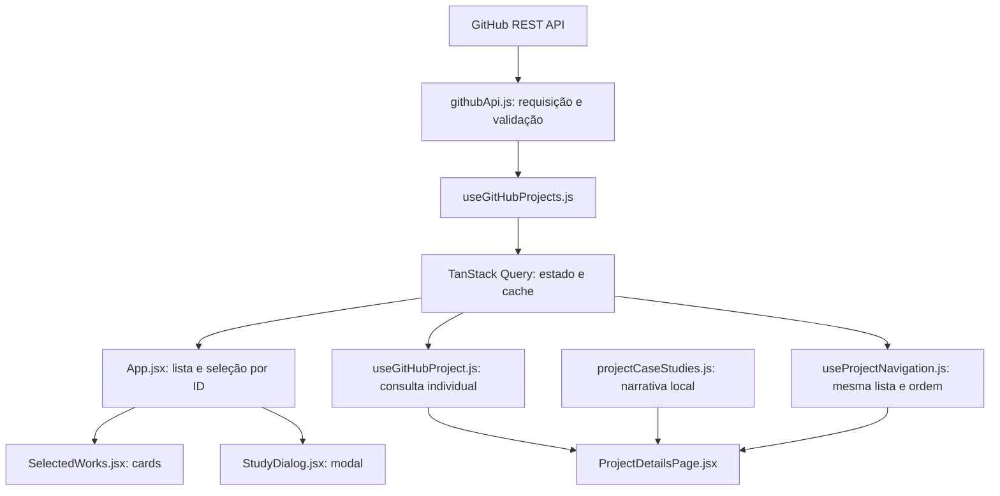

# Digital Excellence — portfólio React

Portfólio em **React 19, Vite 7, JavaScript/JSX e CSS puro**. A seção Projetos carrega repositórios públicos reais do GitHub, sem cadastro manual, preservando a composição editorial assimétrica, o fundo escuro e os detalhes verdes. O restante da landing page mantém seu conteúdo anterior.

## Executar

Requisitos: Node.js **20.19+ ou 22.12+** e npm. Navegador moderno com suporte a `<dialog>` e Intersection Observer.

```powershell
npm ci
Copy-Item .env.example .env
npm run dev
```

Copie o exemplo somente se ainda não tiver um `.env`. O arquivo contém:

```env
VITE_GITHUB_USERNAME=ArthurSgarbi
```

O endereço padrão é `http://127.0.0.1:5173/`. Reinicie o Vite depois de mudar a variável. Ela é pública, incluída durante o build; configure-a também no ambiente de build da Vercel. Sem ela, o desenvolvimento apresenta uma mensagem explicando como configurar a integração.

`.env`, `.env.*`, `node_modules/` e `dist/` continuam ignorados pelo Git; `.env.example` é a exceção versionável. Não há credenciais no exemplo.

## API e dados reais

Listagem principal:

```http
GET https://api.github.com/users/${username}/repos?type=owner&sort=updated&direction=desc&per_page=100
```

Detalhes para acesso direto sem cache:

```http
GET https://api.github.com/repos/${username}/${repositoryName}
```

O service segue a paginação indicada pelo header `Link`, acrescentando `page=2`, `page=3` etc. Só entrega a lista depois que todas as páginas forem validadas; uma falha em qualquer página gera erro explícito, sem publicar uma lista parcial.

Cada projeto utiliza `id`, `name`, `description`, `language`, `html_url`, `homepage`, `updated_at`, `stargazers_count`, `topics`, `fork` e `archived`. A interface exibe nome, descrição, linguagem, data, estrelas, tópicos e links. O ID identifica o item no React e na seleção do modal; o nome gera o slug; forks e arquivados são excluídos da listagem. Por escolha do proprietário, a seção exibe somente `AETHER-front-end`, `meu-caixa`, `site-projeto-shopee` e `anninha-site-novo`, definidos em `formatRepository.js`. Essa seleção controla a visibilidade; os dados continuam vindo automaticamente da API. O número visual é calculado pela posição atual.

Campos ausentes usam “Descrição ainda não informada no GitHub” e “Tecnologia não informada”. O botão “Acessar projeto” aparece apenas para homepage válida em HTTP/HTTPS. Um domínio sem protocolo recebe HTTPS; protocolos inseguros e URLs com credenciais não viram links. Datas são apresentadas em pt-BR/UTC para evitar mudar o dia pela conversão de fuso.

A API foi escolhida porque os repositórios públicos já representam a fonte dos projetos: publicar ou atualizar um repositório elegível atualiza o portfólio na próxima consulta após a expiração do cache.

## Fluxo e separação de responsabilidades



- `githubApi.js` verifica `response.ok`, valida os campos, pagina, limita cada requisição a 15 segundos e lança `GitHubApiError` com códigos compreensíveis.
- `formatRepository.js` adapta dados reais à interface, aplica os fallbacks e filtra a lista. `formatDate.js` centraliza datas.
- `useGitHubProjects.js` centraliza a consulta da listagem. `useGitHubProject.js` reutiliza os dados brutos da mesma lista como dados iniciais de uma consulta individual.
- `App.jsx` seleciona pelo ID, calcula anterior/próximo na lista atual e fecha o modal se o item desaparecer após atualização.
- `HomePage.jsx` reúne as seções existentes. Os componentes de apresentação não fazem `fetch`.
- `ProjectInfo.jsx` apresenta as informações e os links do modal; `ProjectHero.jsx` organiza os metadados e as ações da página individual. `ProjectImage.jsx` concentra o fallback das capas nas duas apresentações.
- `ProjectDetailsPage.jsx` combina o repositório real com o estudo local, quando disponível. Os componentes em `src/components/project-details/` organizam a abertura, contexto, desafio, processo, arquitetura, funcionalidades, galeria, resultados e navegação.
- `useProjectNavigation.js` reutiliza a consulta da lista para encontrar anterior/próximo na ordem da home. Não mantém uma seleção editorial paralela nem uma ordem fixa por nome.

### TanStack Query e estratégia de cache

Um único `QueryClient` fica fora da árvore React e é fornecido em `main.jsx`, junto ao `BrowserRouter`.

- Chaves estáveis por proprietário e nome, normalizados para minúsculas.
- `staleTime`: **10 minutos**; dados ainda recentes são reutilizados.
- `gcTime`: **30 minutos** após a consulta ficar sem observadores. Cache apenas em memória; recarregar o navegador inicia um novo cache.
- Sem consulta periódica ou refetch ao focar a janela. Trocar de seção e abrir o modal não dispara chamadas.
- Remontar ou reconectar pode atualizar dados vencidos. Uma consulta na rota individual usa o horário original do cache da listagem, preservando sua validade.
- No máximo **uma tentativa automática extra**, somente para falha de rede, timeout ou HTTP 5xx. 403/404, limite, configuração e resposta inválida não têm repetição automática.
- O service administra seu próprio timeout. A consulta não consome o sinal de cancelamento do TanStack, permitindo compartilhar a requisição em andamento durante a remontagem do StrictMode.
- Nova tentativa manual com `refetch()`. Dados já disponíveis continuam visíveis se uma atualização falhar.

## Estados da interface

| Estado | Comportamento |
| --- | --- |
| Carregamento | Quatro skeletons com a geometria da grade, fundo escuro, dimensões reservadas e anúncio por `role=status` |
| Sucesso | Cards dos quatro repositórios selecionados, quando originais e não arquivados, ordenados por atualização |
| Lista vazia | “Nenhum projeto público foi encontrado.”, inclusive quando todos os resultados forem filtrados |
| Erro | Mensagem amigável com “Tentar novamente”; falhas técnicas não são exibidas diretamente ao visitante |
| Limite da API | Mensagem específica pedindo para aguardar; sem repetição automática |
| Repositório inexistente | Página 404 própria, distinta da indisponibilidade da API |

403 por limite é identificado por `x-ratelimit-remaining: 0`, `retry-after` ou indicação no corpo; 429 também representa limite. Outros 403 representam acesso indisponível. 404 diferencia perfil ausente na listagem e repositório ausente no detalhe. Respostas inesperadas ou incompletas falham explicitamente.

### Limites e ausência de token

Requisições públicas sem autenticação têm um limite primário de **60 por hora por IP**; limites secundários também podem ocorrer. Cada página consultada conta como uma requisição. O cache reduz o consumo, mas não elimina a dependência do GitHub.

O frontend envia somente `Accept: application/vnd.github+json`, com `credentials: 'omit'`. Não utiliza header de autorização. **Não crie `VITE_GITHUB_TOKEN`**: variáveis com prefixo VITE são expostas ao navegador. Se futuramente for necessário autenticar, o token deve ficar numa função de backend com controle próprio de uso.

## Modal, rotas e acessibilidade

- Clique na imagem/botão abre os detalhes no `<dialog>` nativo.
- Nome e link “Página do projeto” navegam para `/projetos/:repositoryName`.
- O modal mantém fechamento por Escape, botão e clique no fundo; foco inicial no botão fechar; retorno ao acionador; Tab/Shift+Tab incluindo links externos; anterior/próximo e setas do teclado.
- Ao desaparecer o acionador após uma atualização, o foco retorna à seção Projetos.
- Links externos usam `target="_blank"` e `rel="noopener noreferrer"`.
- Títulos semânticos, foco visível, anúncios de estado, textos alternativos e `prefers-reduced-motion` foram mantidos.
- A navegação por âncoras usa o histórico do Router; as animações também observam os cards carregados de forma assíncrona.

Abrir ou atualizar uma URL individual funciona sem cache: primeiro é consultado o endpoint de detalhes; após confirmar que o repositório existe, `useProjectNavigation` habilita a consulta da lista necessária para anterior/próximo. São uma consulta de detalhe e uma consulta compartilhada de listagem, sem chamadas duplicadas entre componentes ou remontagens do StrictMode. A listagem pode envolver mais de uma requisição HTTP se houver paginação. Um detalhe inexistente ou com erro inicial não inicia essa lista.

Ao chegar pela home com cache recente, detalhe e navegação reutilizam os dados existentes, sem consultas extras. Repositórios fora da seleção continuam podendo abrir pela URL individual; recebem os dados reais e, quando não há editorial, a mensagem “Estudo de caso em preparação”. Sem participação na lista filtrada, não recebem vizinhos. Nas extremidades da coleção há apenas o vizinho existente; essa navegação não volta automaticamente do último ao primeiro. Se a ordem falhar, o detalhe permanece disponível e o link para `/#work` permite voltar à coleção.

As páginas de detalhes e 404 têm carregamento de código sob demanda. A importação da rota individual também carrega seu CSS próprio e o conteúdo editorial; a home não importa as galerias. O CSS novo fica sob `.case-study` e os componentes específicos, preservando os estilos da landing page.

Na Vercel, `vercel.json` verifica primeiro o filesystem e depois encaminha rotas da SPA a `index.html`. Arquivos existentes, como imagens, fontes e assets do build, continuam sendo servidos diretamente. O erro 404 de uma rota desconhecida é apresentado pelo React; por ser uma SPA estática, a hospedagem pode responder HTTP 200 ao entregar o HTML.

## Imagens por convenção

Adicione um PNG com **o nome exato do repositório**:

```text
Repositório: sistema-de-gastos
Arquivo: public/images/sistema-de-gastos.png
URL: /images/sistema-de-gastos.png
```

Considere maiúsculas/minúsculas, especialmente no deploy Linux. As imagens apenas apresentam o projeto; seus metadados vêm do GitHub.

Se a imagem não carregar, `ProjectImage` troca uma única vez para `/images/hero-abstract.jpg`, sem loop de `onError`. O texto alternativo identifica a composição de fallback. As imagens mantêm dimensões explícitas; o CSS reserva sua proporção antes do carregamento. A capa da página individual usa carregamento prioritário (`loading="eager"`); as imagens secundárias da galeria usam `loading="lazy"` e só entram na página individual.

As imagens existentes no hero permanecem como apresentação anterior da landing page. Não determinam quais projetos são carregados da API. Origens dos assets e licenças: [ASSETS.md](ASSETS.md).

## Estudos de caso: API e conteúdo editorial

`src/data/projectCaseStudies.js` exporta `projectCaseStudies`, indexado pelo nome do repositório em minúsculas, e `getProjectCaseStudy(name)`. O objeto contém narrativa e evidências locais. A API continua sendo a fonte do nome, descrição, linguagem principal, atualização, estrelas, tópicos, URL do código e homepage. Adicionar um estudo não cria um repositório fictício nem muda a seleção da home.

Os quatro estudos disponíveis são AETHER, Meu Caixa, SYNC Mobile (`site-projeto-shopee`) e a página pessoal `anninha-site-novo`. As etapas são uma leitura técnica do código e da documentação consultados. Papel individual, duração, cronologia e resultados que não foram comprovados aparecem como pendências. Fontes e limites por projeto estão em [docs/CASE_STUDY_CONTENT.md](docs/CASE_STUDY_CONTENT.md).

### Cadastrar ou ampliar um estudo

1. Inspecione o README, código, documentação e imagens do repositório real.
2. Adicione uma entrada em `src/data/projectCaseStudies.js` com o nome exato normalizado para minúsculas. Não copie os campos técnicos controlados pela API.
3. Preencha os blocos abaixo com evidências; mantenha as informações desconhecidas visíveis em `pending`.
4. Coloque imagens reais em `public/images/projects/<nome-exato-do-repositório>/` e referencie a URL iniciada por `/images/`.
5. Abra a rota individual e verifique conteúdo, imagens, fontes, teclado, retorno de foco e navegação. Não inclua o repositório na seleção da home apenas para cadastrar o texto.

Modelo de entrada, com valores ilustrativos que precisam ser substituídos por evidências:

```js
'nome-do-repositorio': {
  eyebrow: 'Categoria editorial',
  headline: 'Ideia central do estudo',
  summary: 'Resumo editorial baseado no projeto real.',
  coverCaption: 'Origem e natureza da capa: captura real ou composição.',
  context: '[Informação a confirmar com o proprietário]',
  problem: 'Necessidade evidenciada pelo projeto.',
  objective: 'Objetivo comprovado na documentação.',
  audience: 'Público declarado; identifique quando for uma inferência.',
  role: '[Informação a confirmar com o proprietário]',
  duration: '[Informação a confirmar com o proprietário]',
  process: [{
    id: 'discovery',
    title: 'Descoberta',
    description: 'Leitura da implementação, sem inventar cronologia.',
    decisions: ['Escolha observável e sua justificativa técnica.'],
    deliverables: ['Entregável encontrado no repositório.'],
    technologies: ['Tecnologia e responsabilidade nesta etapa.'],
    difficulty: 'Dificuldade identificável, quando aplicável.',
    solution: 'Mecanismo encontrado, quando aplicável.',
  }],
  architecture: [{ title: 'Camada ou conexão', description: 'Responsabilidade.' }],
  features: [{ title: 'Recurso', description: 'O que existe.', benefit: 'Utilidade.' }],
  challenges: [{ title: 'Desafio', description: 'Problema técnico.', solution: 'Solução observada.' }],
  results: ['Entregáveis verificáveis; não invente métricas.'],
  learnings: ['Conclusão técnica sustentada pela implementação.'],
  nextSteps: ['Proposta: evolução ainda não implementada.'],
  gallery: [{
    src: '/images/projects/nome-do-repositorio/01-tela.webp',
    pending: true,
    alt: 'Descreva a tela e o estado que a imagem real deverá mostrar.',
    caption: '[Imagem a adicionar] Captura real ainda pendente.',
    width: 1600,
    height: 1000,
  }],
  sources: [{ label: 'README consultado', url: 'https://github.com/owner/repo/blob/main/README.md' }],
  pending: ['Informação que precisa de confirmação.'],
}
```

Os estudos atuais têm seis etapas: descoberta, planejamento, interface, desenvolvimento, testes e entrega. Todas permanecem visíveis sem hover. `difficulty` e `solution` são opcionais. Em `technologies`, explique a função na etapa; o campo não substitui a linguagem principal fornecida pela API.

`sources` registra URLs de evidências específicas e `coverCaption` identifica a origem da capa. As capas de Meu Caixa, SYNC Mobile e Anninha são composições com capturas reais; a capa AETHER é uma captura da página. Identifique dados fictícios na demo e diferencie tela de acesso de painel autenticado. Não use uma imagem conceitual como prova da interface.

### Imagens da galeria

| Caminho em `public/` | Dimensões | Conteúdo real disponível |
| --- | --- | --- |
| `images/projects/AETHER-front-end/01-portal.webp` | 1901 × 911 | Página inicial institucional |
| `images/projects/meu-caixa/01-visao-geral.webp` | 1917 × 905 | Tela pública de acesso, conforme alt e legenda |
| `images/projects/site-projeto-shopee/01-demo.webp` | 1600 × 1100 | Demonstração com dados fictícios |
| `images/projects/anninha-site-novo/01-pagina-pessoal.webp` | 1897 × 902 | Abertura da página pessoal |

Cada projeto tem também um item planejado em `images/projects/<nome-exato>/02-responsivo.webp`, com espaço previsto de 780 × 1688. Esses quatro itens usam `pending: true`: o componente mostra o placeholder sem criar `` nem solicitar um arquivo ausente. Esse booleano do item é diferente do array `pending` do estudo. As medidas planejadas não comprovam a existência da captura.

Ao adicionar uma imagem real, remova `pending` ou defina `false`, informe as dimensões medidas e revise alt e legenda. O texto alternativo deve descrever a tela, a tarefa ou o estado relevante, sem repetir apenas “imagem do projeto”. A legenda informa contexto e origem; registre a procedência em `sources` e na documentação quando necessário. Use WebP ou formato otimizado, mantenha a proporção e evite dados pessoais nas capturas. As origens atuais estão em [docs/CASE_STUDY_CONTENT.md](docs/CASE_STUDY_CONTENT.md).

Uma falha inesperada de arquivo existente também gera placeholder e impede a ampliação desse item. Imagens disponíveis abrem em `<dialog>` com legenda, posição, Escape, setas, foco inicial no fechamento e retorno ao acionador. A imagem ampliada usa `object-fit: contain` para preservar o conteúdo.

### SEO na rota individual

Após obter o repositório, a página atualiza o título para `Nome do projeto | Arthur Sgarbi`, a meta description com o resumo editorial (ou descrição da API) e uma canonical baseada na origem atual e no slug. A descrição anterior é restaurada e a canonical é removida ao sair. Isso ocorre no navegador: não há renderização de HTML por projeto no servidor nem geração adicional de Open Graph. O comportamento de indexadores e prévias sociais depende de sua execução de JavaScript.

## Testar e gerar o build

```powershell
npm test
npm run test:watch
npm run build
npm run preview
```

`npm test` executa a suíte uma vez; `test:watch` acompanha alterações. Os testes usam **Vitest, React Testing Library, user-event, jest-dom e jsdom**, simulando `fetch`. Não fazem chamadas reais ao GitHub.

Cobertura funcional: loading, sucesso, vazio, erros, nova tentativa, filtros, dados ausentes, paginação e falha em página posterior, contrato inválido, links seguros, seleção correta, foco, fechamento ao remover um projeto, rotas diretas/404, remontagem sem cache e compartilhamento da consulta inclusive no StrictMode.

`src/test/caseStudies.test.jsx` cobre estudo completo, repositório sem editorial, etapas visíveis, metadados e ações da API, navegação pela mesma lista, acesso direto e reutilização do cache. `src/test/projectGallery.test.jsx` cobre dimensões e lazy loading, pendência sem requisição, falha de imagem, ampliação, fechamento, teclado e retorno de foco. Esses testes do portfólio não executam as suítes dos produtos apresentados.

**Não há lint configurado neste repositório.** O build gera `dist/`; o preview normalmente usa `http://127.0.0.1:4173/`.

Para validar uma rota individual localmente, inicie `npm run dev` e abra, por exemplo, `http://127.0.0.1:5173/projetos/meu-caixa`. Atualize a página, navegue para anterior/próximo, use voltar/avançar do navegador e retorne por `/#work`. Repita nas rotas `AETHER-front-end`, `site-projeto-shopee` e `anninha-site-novo`. Após gerar o build, repita no preview em `http://127.0.0.1:4173/`. No painel Network, uma abertura direta sem cache deve consultar o detalhe e depois a lista compartilhada; ao chegar pela home com cache recente não deve haver chamadas extras. Confirme também que os caminhos marcados `pending` não foram requisitados. Esse procedimento local não confirma o comportamento da hospedagem após deploy.

### Cenários visuais reproduzíveis

Com o servidor de desenvolvimento, abra `/src/test/browser/index.html`. Esse harness mostra uma faixa “Verificação local · API e metadados simulados” e permite selecionar carregamento, sucesso, vazio, filtragem, indisponibilidade, limite e 404, além do destino (home, rota individual, repositório sem editorial ou galeria de teste). No carregamento, “Liberar resposta” conclui a requisição. Após um erro, “recuperar API” seguido de “Tentar novamente” comprova a recuperação. Um contador e a lista de endpoints mostram as requisições. A galeria de teste reúne duas capturas reais distintas e um arquivo ausente intencionalmente, somente para verificar teclado, foco, navegação e fallback. Reiniciar a sessão cria um cache novo.

Esse ponto de entrada existe somente para testes locais e **não é incluído no build de produção**, cujo único HTML de entrada é `index.html`.

Resultados e limitações efetivamente observados estão em [docs/GITHUB_VERIFICATION.md](docs/GITHUB_VERIFICATION.md). O relatório anterior `docs/VERIFICATION.md` é histórico, referente à versão com estudos ilustrativos.

## Decisão arquitetural

### Escolha

GitHub REST API com TanStack Query.

### Alternativas comparadas

| Alternativa | Avaliação |
| --- | --- |
| Lista manual de projetos | Simples, mas desatualiza e não atende ao carregamento automático exigido |
| GraphQL API do GitHub | Seleciona campos com precisão, mas acrescenta autenticação e complexidade desnecessárias para esta consulta pública |
| `fetch` com estado manual | Evita uma dependência, porém exige implementar cache, repetição, sincronização e compartilhamento |
| SWR | Também resolve cache e revalidação; TanStack Query foi escolhido pelo controle explícito de estados, chaves e políticas por consulta |

### Justificativa

A REST API oferece integração mais direta para listar repositórios públicos. O TanStack Query centraliza cache e estados assíncronos, permitindo compartilhar os mesmos dados entre componentes e evitar requisições repetidas.

### Trade-offs aceitos

- Dependência da disponibilidade do GitHub.
- Limite de requisições e custo adicional por página.
- Necessidade de tratar dados ausentes ou respostas inválidas.
- Maior quantidade de estados na interface.
- Duas dependências de produção adicionais para cache e rotas.
- Cache em memória, com nova consulta após recarregar a página.
- Sem backend para ampliar a cota ou gerar HTML/HTTP 404 por repositório.
- Imagens opcionais dependem da convenção local; fallback pode se repetir entre projetos.

## Arquivos da integração

**Criados:** `.env.example`, `vercel.json`, `vitest.config.js`; `src/services/githubApi.js`; `src/hooks/useGitHubProjects.js` e `useGitHubProject.js`; `src/utils/formatRepository.js` e `formatDate.js`; componentes `ProjectImage`, `ProjectInfo`, `ProjectSkeleton`, `ProjectsError` e `ProjectsEmpty`; páginas `HomePage`, `ProjectDetailsPage` e `NotFoundPage`; testes e harness em `src/test/`; relatório e capturas de validação em `docs/`.

**Alterados:** `package.json`, `package-lock.json`, `index.html`, `src/main.jsx`, `src/App.jsx`, `src/components/SelectedWorks.jsx`, `src/components/StudyDialog.jsx`, `src/hooks/useAnchorNavigation.js`, `src/hooks/useReveal.js`, `src/styles.css` e `README.md`.

**Removido:** `src/data/studies.js`, que continha os projetos fictícios. `.gitignore` já tinha as regras corretas e foi preservado.

**Estudos de caso:** conteúdo em `src/data/projectCaseStudies.js`; navegação em `src/hooks/useProjectNavigation.js`; componentes em `src/components/project-details/`; estilos em `src/pages/project-case-study.css`; galerias em `public/images/projects/`; testes específicos em `src/test/caseStudies.test.jsx` e `src/test/projectGallery.test.jsx`; critérios e fontes editoriais em `docs/CASE_STUDY_CONTENT.md`.

Dependências adicionadas em produção: `@tanstack/react-query` e `react-router-dom`. Desenvolvimento: `vitest`, `@testing-library/react`, `@testing-library/jest-dom`, `@testing-library/user-event` e `jsdom`. Nenhuma biblioteca visual foi adicionada.

## Contato e consulta administrativa

A seção `#contato` aparece após o Diário e antes do rodapé. O navegador chama
`POST /api/contact`; a função Node salva no Supabase para consulta no dashboard. O Resend é uma notificação opcional. Nenhuma
dependência nova foi adicionada. As outras seções mantêm seus componentes e CSS.

**Configuração:** copie os nomes de `.env.example` para `.env` local e para o
ambiente do servidor no deploy. Nunca prefixe estas credenciais com `VITE_`.

| Variável do servidor | Finalidade |
| --- | --- |
| `SUPABASE_URL` | URL do projeto Supabase |
| `SUPABASE_ANON_KEY` | Chave pública do projeto, usada pelo servidor para Auth |
| `SUPABASE_SERVICE_ROLE_KEY` | Chave privada service_role para banco, somente servidor |
| `RESEND_API_KEY` | Opcional: chave privada do serviço de e-mail |
| `CONTACT_FROM_EMAIL` | Opcional: remetente em domínio verificado no Resend |
| `CONTACT_TO_EMAIL` | Opcional: e-mail do proprietário para notificações |
| `CONTACT_HASH_SECRET` | Opcional: segredo dedicado ao hash dos IPs; usa a chave privada do banco quando ausente |
| `CONTACT_ADMIN_USER_IDS` | UUIDs autorizados do Supabase Auth, separados por vírgula |

1. Execute `supabase/migrations/202610270001_contact.sql` no SQL Editor do Supabase.
   A migração cria mensagens, controle de frequência e a função de reserva atômica.
   RLS fica habilitada sem políticas públicas; os privilégios de `anon` e
   `authenticated` são revogados. Somente a API com service_role acessa essas tabelas.
2. Crie o usuário administrativo no Supabase Auth e coloque seu UUID na lista
   `CONTACT_ADMIN_USER_IDS`. Desabilite cadastros públicos se não forem necessários.
   O backend verifica a sessão no Auth e a lista de UUIDs antes de consultar dados.
3. Opcionalmente, verifique o domínio no Resend e configure remetente, destinatário e chave para notificações por e-mail. Sem essas variáveis, as mensagens continuam chegando ao dashboard. `CONTACT_HASH_SECRET` é opcional: quando ausente, o servidor usa a chave privada do banco como chave do HMAC, sem expor ou salvar o IP.
4. Em dois terminais, execute `npm run dev:api` (porta 3001) e `npm run dev`
   (Vite na 5173, com proxy para `/api`). Reinicie a API após mudar `.env`.
   `npm run preview` sozinho serve apenas o frontend; não executa funções.
5. Acesse `/dashboard`, entre com e-mail/senha do usuário autorizado. O token fica
   apenas na memória; reload ou Sair exige novo login. A lista tem páginas de 50,
   prévia, conteúdo completo e resultado do serviço de e-mail. Não há cadastro
   público ou acesso direto do frontend ao banco.
6. Na Vercel, os arquivos `api/contact.js` e `api/admin.js` são funções Node.
   As rotas do SPA continuam disponíveis; caminhos desconhecidos de API retornam 404.

**Falhas e duplicidade:** honeypot, limite de tamanho, validação no servidor e cooldown
de 60 segundos por IP (hash) protegem o envio. A reserva usa locks transacionais no
Postgres e UUID por tentativa. Retry sem editar reaproveita a linha e a chave de
idempotência do Resend. Mensagens já confirmadas retornam sucesso sem reenviar.
Retries de mensagens já persistidas são confirmados comparando o fingerprint, mesmo sem e-mail enviado.
Se editar o formulário após erro, ele passa a representar uma nova mensagem.
O sucesso confirma o recebimento no banco e no dashboard. Falha ao salvar não retorna sucesso.
Falha no Resend não impede esse recebimento; o servidor tenta registrar `email_status=failed`.
`pending` pode indicar notificação por e-mail não configurada; `sent` significa aceito pelo Resend,
não entrega na caixa de entrada. Não há worker de recuperação automática de notificações.
Planeje retenção e limpeza periódica de mensagens e hashes de controle de frequência.

**Verificação local:** `npm test`, `npm run build` e `git diff --check`.
Não há lint configurado neste projeto. Em Windows com EPERM de temporários,
aponte `TEMP` e `TMP` para `node_modules/.cache/contact-tests` antes dos testes.
O harness `/src/test/browser/contact.html` oferece sucesso, falha do servidor e
falta de conexão simulados, com contador de requisições; não envia e-mails e não
é incluído no bundle de produção. Relatório em `docs/CONTACT_VERIFICATION.md`.

**Pendências externas:** o `.env` existente contém apenas a configuração GitHub.
Banco, credenciais, usuário autorizado e remetente precisam ser configurados.
Não foram comprovados persistência real, entrega de e-mail, RLS aplicada ou login
real do dashboard. Para homologar, envie uma mensagem em staging, confira a linha,
o recibo do Resend e a caixa de entrada; teste também visitante, token inválido,
usuário autenticado não autorizado e acesso direto às tabelas com chave pública.

Referências da integração: [RLS no Supabase](https://supabase.com/docs/guides/database/postgres/row-level-security),
[validação de usuário](https://supabase.com/docs/reference/javascript/auth-getuser) e
[idempotência no Resend](https://resend.com/changelog/idempotency-keys).

## Referências oficiais

- [Endpoints de repositórios do GitHub](https://docs.github.com/en/rest/repos/repos#list-repositories-for-a-user).
- [Limites da REST API](https://docs.github.com/en/rest/using-the-rest-api/rate-limits-for-the-rest-api).
- [TanStack Query: políticas de cache e revalidação](https://tanstack.com/query/latest/docs/framework/react/guides/important-defaults).
- [React Router: rotas declarativas](https://reactrouter.com/7.18.4/start/declarative/routing).
- [Vercel: configuração de rotas](https://vercel.com/docs/project-configuration/vercel-json#routes).

## Dashboard do proprietário

Acesse `/login`; `/dashboard` exige uma sessão validada pelo servidor. Consulte
[docs/ADMIN_DASHBOARD.md](docs/ADMIN_DASHBOARD.md) para ativação, endpoints,
segurança, migration e evidências de teste. Não há cadastro ou recuperação de
senha pelo portfólio. A senha deve ser definida manualmente no Supabase Auth.
