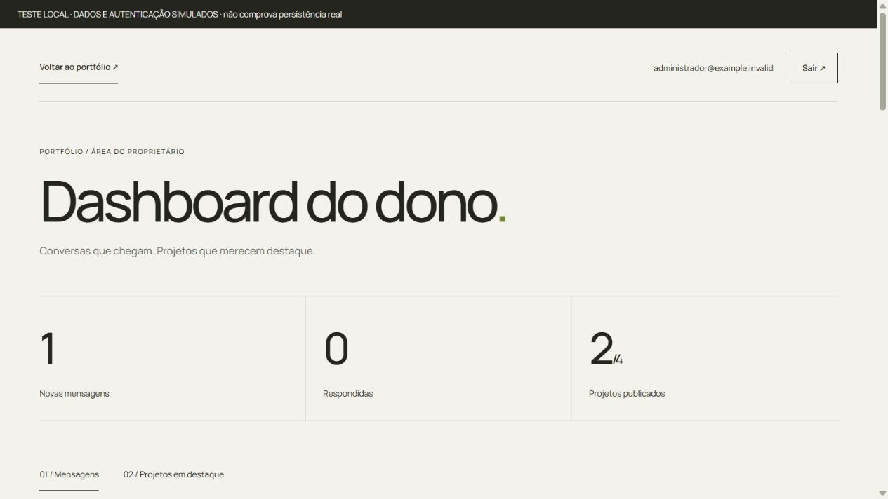
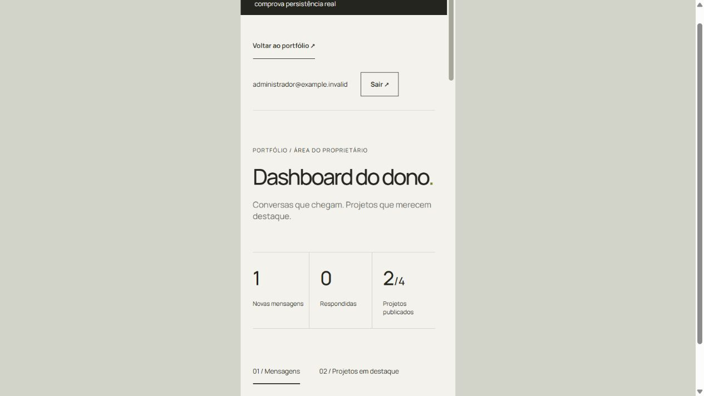

# Dashboard do proprietário

## O que foi implementado

Login em `/login`, rota `/dashboard` protegida, logout, revalidação da sessão,
resumo global de mensagens, leitura integral, filtros, paginação de 50 registros,
status nova/visualizada/respondida/arquivada e gerenciamento de até quatro destaques.
A UI reutiliza Manrope, cores e espaçamentos do portfólio, com CSS restrito à área administrativa.
Não foram editados os componentes das outras seções da home.

## Ativação no Supabase e na hospedagem

1. Aplique primeiro `supabase/migrations/202610270001_contact.sql` se ainda não foi executada.
2. Aplique a NOVA migration `supabase/migrations/202610280001_admin_dashboard.sql`.
   A migration anterior foi preservada. A nova adiciona `responded`, cria a tabela
   `featured_projects`, RLS, restrições, seleção inicial e duas funções restritas ao servidor.
   Aplique também `supabase/migrations/202610280002_featured_safe_delete.sql`, que mantém a substituição compatível com a exigência de WHERE do banco.
3. No Supabase Auth, crie manualmente o usuário `arthursgarbi037@gmail.com`, defina
   sua senha e confirme seu e-mail. Desabilite cadastro público nas configurações do provedor.
4. Copie SOMENTE o UUID desse usuário para `CONTACT_ADMIN_USER_IDS`. Embora o servidor
   aceite uma lista por compatibilidade, mantenha um único UUID neste projeto.
5. Configure as variáveis abaixo no ambiente local e na hospedagem e publique o código.
   Não publique o arquivo `.env`. Não coloque senhas no código ou nas variáveis VITE_.
6. Faça os testes reais de login, cookie, logout, RLS e persistência descritos abaixo.

| Variável | Uso |
| --- | --- |
| `VITE_GITHUB_USERNAME` | Perfil público da integração existente com o GitHub |
| `SUPABASE_URL` | URL do projeto, somente no servidor |
| `SUPABASE_ANON_KEY` | Chamadas do servidor ao Supabase Auth |
| `SUPABASE_SERVICE_ROLE_KEY` | Acesso do servidor ao banco, nunca enviada ao navegador |
| `CONTACT_ADMIN_USER_IDS` | UUID do proprietário autorizado |
| `NODE_ENV=production` | Garante o atributo Secure no cookie em produção; definido pelo runtime de produção |

As variáveis existentes de Resend e contato continuam necessárias para o envio do formulário:
`RESEND_API_KEY`, `CONTACT_FROM_EMAIL`, `CONTACT_TO_EMAIL`, `CONTACT_HASH_SECRET`.
Nenhuma dependência nova foi adicionada.

## Arquitetura e decisões

Em desenvolvimento, `npm run dev` atende o frontend e `/api` no mesmo servidor Vite.
As credenciais privadas são carregadas somente no processo Node; o navegador recebe
apenas variáveis `VITE_`. `npm run dev:api` continua disponível para uma API separada,
mediante `API_PROXY_TARGET` explícito no ambiente do Vite. Reinicie após editar `.env`.
Falhas em `/api/featured` são identificadas como falhas na seleção de destaques,
sem atribuir o erro ao GitHub. No login, falha de conexão ou HTTP 5xx é diferenciada
da recusa de acesso (401/403), que continua genérica.

O navegador envia as credenciais somente ao endpoint de sessão por HTTPS em produção.
O servidor autentica no Supabase, confere o UUID na allowlist e grava o access token em
cookie HttpOnly, SameSite=Lax, Secure em produção, limitado a `/api/admin`.
O token não volta no JSON nem vai para localStorage/sessionStorage. Todas as respostas
administrativas usam `Cache-Control: no-store`. Mutações verificam origem e exigem JSON
(exceto DELETE), reduzindo a possibilidade de CSRF. A mensagem de erro é genérica.
O frontend não é a autoridade de acesso: cada consulta e alteração revalida o usuário no Auth.

A sessão é conferida no carregamento, ao voltar à janela, a cada 60 segundos e em toda
operação administrativa. Ao receber 401/403, o cliente limpa o cache administrativo e retorna
ao login. Não há refresh token: após o vencimento (no máximo uma hora), é necessário entrar
novamente. Esse limite reduz a complexidade e mantém a expiração explícita. Uma tela ociosa
pode levar até 60 segundos para perceber o vencimento; nenhuma operação continua autorizada
nesse intervalo sem validação do servidor. Reload conserva a sessão pelo cookie.
Logout chama o endpoint de revogação do Supabase e remove o cookie.

`contact_messages` nunca é consultada pelo navegador. A API seleciona apenas os campos
necessários e não retorna `email_error`, fingerprint, identificadores do provedor ou rate limits.
As contagens são globais e independem do filtro/página. `sent` significa aceito pelo Resend,
não entrega confirmada na caixa de entrada. Marcar respondida apenas registra o status;
não envia uma resposta por e-mail.

Destaques guardam apenas nome e posição; dados técnicos continuam vindo do GitHub.
O endpoint público retorna somente esses dois campos. A home cruza as respostas, respeita
a ordem editorial e ignora repositórios privados, arquivados ou removidos. O catálogo
administrativo inclui repositórios públicos ativos, inclusive forks. A seleção é comparada
sem diferenciar maiúsculas/minúsculas, como os nomes no GitHub.
O limite é validado na UI, API e banco (posição única entre 0 e 3).
A RPC substitui a seleção inteira em uma transação com lock, evitando perda parcial ou
mistura de seleções em gravações concorrentes. A última gravação completa prevalece.
As alterações só aparecem como salvas depois de confirmação do servidor. Atualiza-se também
o cache público. Reabrir a home consulta novamente a seleção.

Foi adotado o data router do React Router para bloquear navegação com rascunho não salvo,
inclusive Voltar do navegador. `beforeunload` cobre reload/fechamento quando o navegador
permite o aviso nativo. Por segurança, expiração da sessão continua tendo prioridade.

## Endpoints

| Método e rota | Resultado |
| --- | --- |
| POST `/api/admin?resource=session` | Login com `{email,password}` e cookie HttpOnly |
| GET `/api/admin?resource=session` | Verifica sessão e autorização |
| DELETE `/api/admin?resource=session` | Revoga sessão e remove cookie |
| GET `/api/admin?resource=messages&offset=0&status=new` | Até 50 mensagens e contagens globais; status vazio lista todas |
| PATCH `/api/admin?resource=messages&id=UUID` | Atualiza `{status}` e retorna mensagem; 404 se ausente |
| GET `/api/admin?resource=featured` | Consulta seleção para administração |
| PUT `/api/admin?resource=featured` | Salva `{repositories:["nome", "outro"]}` em ordem; aceita seleção vazia |
| GET `/api/featured` | Consulta pública somente de nomes e posições |

A rota de atualização usa query string para preservar a função serverless `/api/admin`
existente; oferece a mesma operação do exemplo `/api/admin/messages/:id`, sem adicionar rewrites.

## Desenvolvimento e testes

Execute `npm run dev` para iniciar frontend e API integrada. Para usar dois processos,
execute também `npm run dev:api` e configure explicitamente `API_PROXY_TARGET` no Vite.
`API_PORT` altera a porta da API separada (padrão 3001); sem `API_PROXY_TARGET`,
o Vite atende `/api` diretamente e não depende dessa porta.

Os testes Vitest usam serviços simulados e cobrem os 16 grupos funcionais do pedido:
acesso, login e credenciais inválidas, 403, sessão expirada, logout, listagem,
status persistindo em nova consulta, falha de atualização, filtros, limite de quatro,
reordenação, salvamento, home com seleção, repositório removido, teclado e aria-live.
Também cobrem cookie Secure/HttpOnly, CSRF, validação de UUID/status, 404,
campos da consulta pública, contagens globais e bloqueio de saída.
Isso não executa PostgreSQL nem comprova RLS ou autenticação reais.

No Windows, se Vitest falhar com EPERM em temporários:

```powershell
New-Item -ItemType Directory -Force node_modules/.cache/admin-tests | Out-Null
$env:TEMP=(Resolve-Path node_modules/.cache/admin-tests).Path
$env:TMP=$env:TEMP
npm test
```

Harness de navegador exclusivo do desenvolvimento, não importado pelo entrypoint de produção:
`/src/test/browser/admin.html?session=valid` (sessão fictícia válida), sem query (visitante)
e `?session=expired` (sessão fictícia expirada). Login no harness aceita dados fictícios;
não use sua senha real. Os dados reiniciam ao recarregar; não há persistência real.
`/src/test/browser/admin-mobile.html` oferece viewport real de iframe com 390 × 844.

## Evidências e limitações

- Vitest: 100 testes passaram em 8 arquivos na execução final.
- Build Vite: passou. `git diff --check`: passou.
- Navegador: acesso direto real a `/dashboard` redirecionou a `/login`.
- Na verificação inicial, as quatro variáveis de Supabase/admin estavam vazias. A conexão foi concluída depois; veja `SUPABASE_SETUP.md`. Sem essas variáveis,
  a API responde com falha genérica; não há fallback que libere administração.
- No harness: login, logout, entrada com sessão expirada, leitura/status/filtro, seleção, limite de quatro, reordenação, salvamento e ordem da home conferidos. Reload com cenário de sessão válida também conferido. Dados identificados como simulados. Desktop e iframe mobile de 390 px inspecionados visualmente; imagens em `admin-desktop.png` e `admin-mobile.png`. Uma sessão nova, aberta após as edições, ficou sem erros ou avisos no console. Durante HMR do contexto de autenticação houve erro transitório; ele não reapareceu ao abrir uma sessão limpa.
- Foco visível, labels, botões nativos, estados textuais, aria-current e aria-live implementados.
- Contrastes calculados: texto principal/fundo 13,78:1; texto secundário/fundo 4,98:1; texto/botão verde 11,78:1; indicador de foco/fundo 4,87:1. Os pares de texto excedem AA (4,5:1). Isso não substitui uma auditoria completa de acessibilidade.
- Na etapa inicial, não havia validação com Supabase real ou PostgreSQL/RLS. A configuração e a verificação reais posteriores estão registradas em `SUPABASE_SETUP.md`. Permanecem sem validação: leitor de tela, toque físico,
  Resend real, deploy ou Vercel em produção.

Antes da publicação, confirmar: login real do proprietário, 403 para outro UUID,
reload válido e expirado, logout, PATCH persistindo após nova consulta e nova sessão,
ordem dos destaques após reload, rejeição de escrita direta com anon/authenticated,
limite/rollback no PostgreSQL e cookie Secure em HTTPS.

## Arquivos da implementação

- API: `api/admin.js`, `api/featured.js`, `server/devApi.js`.
- Banco: `supabase/migrations/202610280001_admin_dashboard.sql` e `supabase/migrations/202610280002_featured_safe_delete.sql`.
- Cliente: `src/services/adminApi.js`, `src/hooks/useAdminAuth.jsx`,
  `src/hooks/useGitHubProjects.js`, `src/utils/formatRepository.js`.
- UI e rotas: `src/App.jsx`, `src/main.jsx`, `src/pages/LoginPage.jsx`,
  `src/pages/DashboardPage.jsx`, `src/pages/admin.css`, `src/components/UnsavedChanges.jsx`.
- Testes: `src/test/adminBackend.test.js`, `src/test/contactDashboard.test.jsx`,
  `src/test/contactBackend.test.js`, `src/test/githubApi.test.js`,
  `src/test/projects.test.jsx`, `src/test/caseStudies.test.jsx`,
  `src/test/browser/admin.html`, `src/test/browser/admin.jsx`, `src/test/browser/admin-mobile.html`.
- Configuração/documentação: `.env.example`, `vite.config.js`, `README.md` e este documento.

### Capturas da verificação local

Dados simulados, sem conexão ao Supabase:




