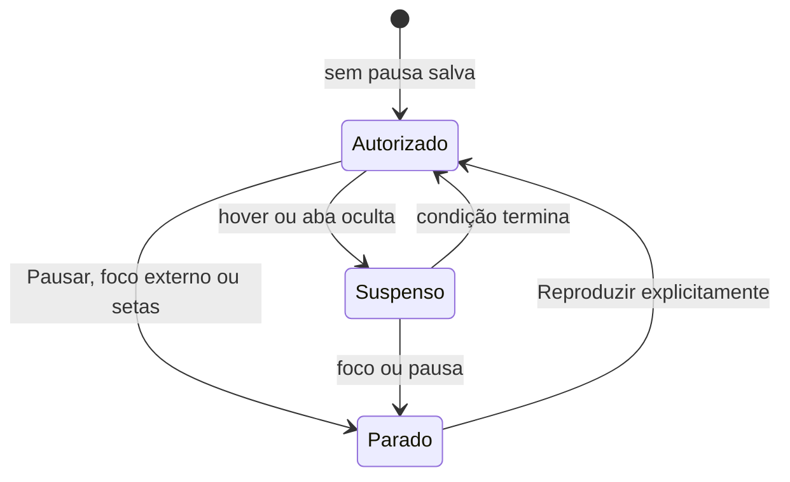

# Correções da auditoria — 30/10/2026

Escopo: controle acessível do carrossel e investigação dos testes de contato/projetos. Base inicial: `7476630e10fb363b04685ce7af79d0b45a2648df`; o Git estava limpo. Foram lidos integralmente `RELATORIO-TESTES.md` e `PLANO-DE-ESTUDOS.md` da pasta `../auditoria-2026-10-30`, e a implementação atual foi conferida antes da edição.

## Carrossel: causa e solução

Em `src/components/Hero.jsx`, a condição de reprodução não incluía hover. O foco era uma suspensão temporária desfeita por `onBlur`. Isso permitia trocar a imagem sob o ponteiro e retomar sem autorização após sair com o teclado.

A solução mantém estados pequenos, sem biblioteca adicional:

```text
autoPlaying = !paused && !hovered && !reducedMotion && !pageHidden
```

`paused` representa a decisão persistente de parar: Pausar, entrada de foco vinda de fora e anterior/próxima a ativam. Somente Reproduzir a remove. A decisão continua armazenada em `sessionStorage`, inclusive quando a interrupção veio do foco. Hover e aba oculta apenas suspendem uma reprodução autorizada. Movimento reduzido impede o avanço automático e mantém as setas manuais.



O diagrama mostra a autorização e as suspensões; a preferência de movimento reduzido bloqueia o timer em qualquer estado. Foco entre controles internos não revoga uma retomada explícita. Sair do componente também não altera a autorização. A entrada seguinte, vinda de fora, interrompe novamente.

Há um cuidado adicional na interação com mouse: `pointerdown` acontece antes do foco, que por sua vez pode mudar Pausar para Reproduzir antes do `click`. Uma ref guarda a ação iniciada pelo ponteiro. Cliques de teclado usam o estado atual. Isso evita que o primeiro clique em Pausar termine reproduzindo.

O efeito cria no máximo um intervalo e o limpa em toda suspensão/desmontagem. O estado inicial de visibilidade lê `document.hidden`. Os listeners de movimento/visibilidade continuam com limpeza. As imagens, legendas, slides ocultos, nomes acessíveis e `aria-live` foram preservados.

Referência consultada: [W3C APG — Carousel Pattern](https://www.w3.org/WAI/ARIA/apg/patterns/carousel/). O APG pede parada ao receber foco, retomada explícita e suspensão sob o mouse; não se trata de certificação geral de conformidade WCAG.

## Investigação dos testes

### O que foi observado

- Baseline de contato/projetos, dois workers: **23/23 passaram** em 18,44 s. O caso de envio duplicado levou 3.349 ms; nova tentativa de envio, 2.299 ms; navegação com cache, 1.293 ms.
- Primeira execução com os novos testes do carrossel: o próprio teste combinava timers falsos globais com `user-event`/RTL e travou no esvaziamento de promessas. Foi corrigido no harness: somente `setInterval`/`clearInterval` são controlados. Isso não foi classificado como defeito do produto nem causa dos testes antigos.
- Execução direcionada com dois workers: **32/35 passaram** em 53,80 s. Reproduziu a espera sem H1 do estudo e trouxe dois timeouts de 5 s em testes do modal. O DOM da falha de navegação ainda continha a página anterior. Os 12 casos do carrossel passaram.
- Uma sonda temporária com a página real mediu: home 1.179 ms; âncora/prévia 538 ms; clique no estudo 192 ms; importação lazy aproximadamente 281–285 ms; espera da importação e atualização do React 358 ms. A sonda e o contato passaram, **5/5**. Esses tempos pertencem a essa execução, não à execução que falhou.
- Após sincronização e isolamento explícitos: **35/35 passaram** com um worker, em 55,73 s. O contato duplicado levou 1.019 ms e a nova tentativa, 791 ms. Como a carga variou, a diferença entre execuções não é um benchmark controlado nem prova da causa única do timeout anterior.
- A rechecagem com dois workers também passou: **35/35**, em 30,27 s; envio duplicado 923 ms, nova tentativa 673 ms e navegação com cache 2.055 ms. Não houve build nem outro teste de navegador executando em paralelo à suíte.

Os JSONs originais dessas etapas estão em `../auditoria-2026-10-30/correcao-*.json`, fora do repositório. A sonda foi preservada ali como `correcao-stability-profile.jsx`; não integra a suíte final.

### Mudanças nos testes e motivo

1. **Contato:** a preparação usa `user.paste` após clicar nos quatro campos. Isso mantém eventos reais de entrada/alteração e evita simular cada letra em testes cujo objetivo é envio, duplicidade e nova tentativa. O teste continua digitando após sucesso para verificar a remoção do feedback. Todas as asserções anteriores foram mantidas, com nova conferência do payload completo. A requisição é um mock com dados fictícios.
2. **Rota lazy:** após o clique real em Ver estudo completo, o teste aguarda `vi.dynamicImportSettled()` dentro de `act`. A espera acompanha a dependência que estava pendente, antes de procurar o H1. O módulo real continua lazy e as verificações de navegação, retorno e uma única consulta permanecem. [API oficial do Vitest](https://vitest.dev/api/vi.html#vi-dynamicimportsettled).
3. **Isolamento:** o mock de destaques é reiniciado antes de cada caso; os componentes são desmontados antes de limpar seus QueryClients, inclusive após falhas. Isso explicita a ordem de limpeza e elimina filas de respostas entre casos. Não foi demonstrado que uma resposta residual causou as falhas históricas.
4. **Carrossel:** sete novos casos, incluindo Enter e Espaço, cobrem hover, saída de foco, retomada explícita, ordem de eventos do mouse, visibilidade, preferência dinâmica e limpeza em StrictMode. O relógio avança por múltiplos intervalos sem esperas reais de sete segundos.

Nenhum timeout global foi aumentado. Nenhuma asserção existente foi removida ou afrouxada. A sincronização por interação e a espera por DOM continuam conforme a [documentação da Testing Library](https://testing-library.com/docs/dom-testing-library/api-async/).

### Incerteza preservada

A instabilidade foi reproduzida; não há evidência suficiente para atribuir todos os timeouts a uma causa única. A importação e a atualização do React precisavam de sincronização explícita no teste de navegação; os demais excessos de tempo variaram com a execução. Não foram capturados perfil de CPU nem tempo da importação justamente no instante da falha. Um resultado aprovado não garante estabilidade sob qualquer carga ou quantidade de workers. Não houve evidência de quebra do contato ou da navegação real que justificasse alterar esses componentes de produção.

## Validação no navegador

Script: [verify_browser.py](correcao-2026-10-30/verify_browser.py). Executa Chromium headless, observa consultas públicas reais e bloqueia todos os métodos de escrita. Não envia contato, não autentica e não altera destaques.

Resultados finais e critérios: ver [browser-results.json](correcao-2026-10-30/browser-results.json). Capturas ficam na mesma pasta. Hover, foco, teclado, cliques, reload e navegação são interações reais no navegador com relógio controlado. A preferência de movimento é emulada pelo navegador. `document.hidden` e `visibilitychange` são simulados explicitamente; a alternância entre abas headless também é sondada, sem afirmar que equivale à troca real de janela no sistema operacional.

O Chromium headless manteve `document.hidden === false` ao trocar para outra aba. Portanto, a suspensão por visibilidade foi validada por simulação do evento/propriedade e pelos testes de componente; a troca real de aba no sistema operacional continua sendo uma limitação explícita.

Na primeira execução do script, a medição de layout aguardou notificações do TanStack Query com o relógio ainda pausado; por isso não encontrou os cards. Retomar o relógio antes dessa fase resolveu a falha do harness. A saída do Python também foi fixada em UTF-8 para imprimir setas. Essas falhas da automação não são classificadas como defeitos da página.

Ao revisar as capturas, a imagem do carrossel aparecia vazia em algumas capturas maiores, embora o recurso estivesse decodificado. A rechecagem visual foi separada num **novo BrowserContext, sem relógio instalado**: abrir apenas uma nova Page ainda herdava o relógio do contexto. A imagem apareceu nas capturas do componente em 768 px e em 1440 px claro, mas isso não eliminou todas as capturas vazias. Portanto, não se atribui esse problema somente ao relógio nem se afirma uma causa de renderização comprovada. A rechecagem de layout está em [layout-results.json](correcao-2026-10-30/layout-results.json); os resultados comportamentais anteriores foram mantidos. A sonda [inspect_image_paint.py](correcao-2026-10-30/inspect_image_paint.py) complementa essas evidências com contextos novos para cada tema/tamanho, rolagem até a imagem e captura do carrossel.

**Resultado da sonda:** as oito capturas `reel-*` mostram a imagem, legenda e controles corretamente; foram inspecionadas visualmente. O [resultado estruturado](correcao-2026-10-30/image-paint-results.json) registra carregamento completo, dimensões positivas, visibilidade e opacidade da imagem. Não foi necessário alterar imagens, CSS ou código de produto para obtê-las. A causa exata dos quadros vazios nas outras capturas não foi determinada; essas capturas foram preservadas, mas as evidências visuais preferenciais do carrossel são `reel-*`. Veja a [galeria de screenshots](correcao-2026-10-30/README.md).

## Execuções finais

| Verificação | Comando / resultado |
| --- | --- |
| Direcionados, um worker | `npm test -- src/test/hero.test.jsx src/test/contact.test.jsx src/test/projects.test.jsx --maxWorkers=1` — **35/35**, 55,73 s |
| Direcionados, dois workers | Mesmo comando com `--maxWorkers=2` — **35/35**, 30,27 s; [JSON](correcao-2026-10-30/tests-targeted.json) |
| Suíte completa | `npm test -- --maxWorkers=2` — **139/139 em 12 arquivos**, 78,82 s; [JSON](correcao-2026-10-30/tests-full.json) |
| Build | `npm run build` — **aprovado**, Vite 7.3.7, 131 módulos, 10,53 s |
| Whitespace | `git diff --check` — aprovado, saída vazia |
| Chromium | **8/8 fluxos compostos**; medições nas oito combinações de layout aprovadas; sem `pageerror` registrado |

As execuções com JSON acrescentaram `--reporter=verbose --reporter=json --outputFile.json=...` aos comandos acima. A suíte cresceu de 132 para 139 testes; não houve remoção de testes existentes. Testes e build foram executados separadamente. O Vitest precisou executar fora do sandbox porque a primeira tentativa foi bloqueada por `EPERM` ao renomear seu próprio cache temporário, antes de executar qualquer teste.

### Critérios de aceite e camada de evidência

| Critério | Evidência |
| --- | --- |
| Hover impede avanço; saída retoma somente se autorizada | Relógio de componente e mouse real no Chromium |
| Sair do hover não desfaz pausa manual nem interrupção por foco | Teste de componente; interrupção por foco também no Chromium |
| Entrada de foco para; saída não reinicia | Componente e foco real no Chromium |
| Reproduzir funciona com Enter e Espaço mantendo foco | Componente e teclado real no Chromium |
| Clique em Pausar respeita ordem pointerdown/focus/click | `user-event` e mouse real no Chromium |
| Anterior/próxima são circulares e mantêm a pausa | Componente e Chromium |
| Pausa permanece após recarregar | Remontagem em componente e reload real |
| Movimento reduzido permite navegação manual sem rotação | Mock de media query e emulação de mídia no Chromium |
| Aba oculta suspende e voltar não desfaz pausa | Propriedade/evento **simulados**; troca real não certificada |
| Um intervalo e limpeza de listeners | Teste em StrictMode, `getTimerCount` e spy de remoção |
| Slide, imagem, legenda, nome e `aria-live` coerentes | Consultas de acessibilidade e asserções de componente; leitor de tela real não testado |
| Home 320/390/768/1440 em claro/escuro | Oito medições, capturas e revisão visual; caveat de pintura nas capturas descrito acima |
| Menu e modal preservados | Escape, foco de retorno, Contato, ciclo Tab/Shift+Tab, setas e fechamento após rolar no Chromium |
| Diário → prévia → estudo → retorno | Navegação real; GitHub e destaques públicos HTTP 200; estudo mantém Sobre o projeto / O desafio |

### Reproduzir a validação do navegador

Com o servidor local ativo, numa instalação que tenha Playwright e Chromium:

```powershell
python docs/correcao-2026-10-30/verify_browser.py --help
python docs/correcao-2026-10-30/verify_browser.py
python docs/correcao-2026-10-30/verify_browser.py --layout-only
python docs/correcao-2026-10-30/inspect_image_paint.py
```

Nesta máquina foi passado `--deps C:\Users\Arthur\.codex\visualizations\2026\10\30\01a18d4d-a544-7603-8726-8884db7d27fd\python-deps`, reaproveitando a instalação isolada da auditoria. Nenhuma dependência foi acrescentada ao projeto. `--base` permite alterar a URL local. A verificação foi feita no Vite existente, que respondeu HTTP 200 e entregou o componente corrigido; não foi iniciada outra instância.

## Limites

Validação local em Chromium; não certifica leitor de tela real, Safari/Firefox, dispositivo físico, produção, entrega de e-mail, banco ou RLS. Nenhuma credencial ou valor de `.env` foi registrado. Identidade visual, textos e formato curto dos estudos foram preservados. Não foram feitos commit, push ou deploy.
