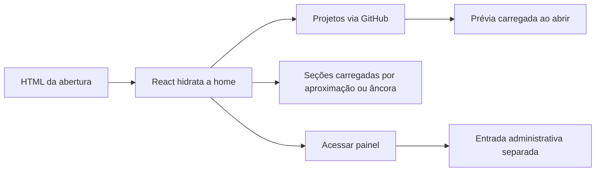

# Imagens editoriais e carregamento inicial — 31/10/2026

## Problemas e correções

Nos quatro estudos, `ProjectHero` substituía a imagem pela captura editorial, mas preservava o `imageSrcSet` da capa do card. O navegador escolhia a capa pelo srcset. Ao usar uma evidência editorial, agora o componente remove esse conjunto. A regressão confere os atributos dos quatro estudos; a validação em Chromium confere `currentSrc` e decodificação em 320, 390 e 1440 px.

A home também concentrava código, criação de elementos e cálculos de layout na abertura. As mudanças foram:

- Pré-renderizar a abertura da home no build, incluindo título, descrição, links, carrossel e estados iniciais. O React hidrata esse HTML. Preferências de tema, pausa e movimento recebem um estado inicial compatível com o HTML e são sincronizadas com o navegador após a hidratação.
- Montar Processo, Diário e Contato ao se aproximarem da tela, com antecipação de 600 px, ou ao navegar/focar suas âncoras. O alvo de foco permanece estável. Há fallback de montagem imediata quando IntersectionObserver não está disponível. Essas seções não são conteúdo estático completo no HTML inicial; dependem da execução de JavaScript e da aproximação/navegação.
- Carregar a prévia de projeto apenas quando o usuário a abre, mantendo contenção e retorno de foco.
- Separar a entrada de login/dashboard da entrada pública. A área administrativa mantém seu data router e o bloqueio de navegação com rascunho pendente. O link do rodapé faz navegação de documento para carregar essa entrada. O restante da navegação pública continua no cliente.
- Estabilizar a transformação e seleção de repositórios. A lista conserva a referência quando os dados não mudam, evitando refazer o efeito de revelação sem necessidade.
- Usar os retângulos entregues pelo IntersectionObserver, removendo leituras síncronas de geometria na montagem do efeito de revelação.

O bundle inicial público caiu de **402,37 kB para 329,67 kB** no build local; comprimido por gzip, de **127,43 kB para 104,62 kB** (aproximadamente 18% de redução). Código adiado continua disponível para as respectivas interações; não foi removido do produto.

## Build e publicação

`npm run build` continua sendo o comando único. O Vite produz o cliente público; `prepare-page-html.mjs` gera a abertura no servidor de build e uma entrada independente para login/dashboard, além dos metadados e documentos existentes. Não há nova dependência. `.prerender/` é um artefato local ignorado pelo Git.

O HTML pré-renderizado contém somente a apresentação pública e placeholders de projetos. Dados GitHub continuam vindo da consulta do cliente. Nenhuma sessão administrativa ou credencial local é serializada.

Deployment final: `dpl_6wfL8bnD3XZqHGe5CwGK2fy7RHg5`, Production, READY, em https://cp-6-web-dev-eight.vercel.app/. Fontes publicadas diretamente pela API da Vercel, sem `.env`, commit ou push.

## Validação

- Build local e build da Vercel concluídos.
- 146/146 testes passaram. Os quatro estudos receberam regressão para impedir srcset de capa na captura editorial. O teste da prévia aguarda a abertura assíncrona do módulo.
- Navegador: 12 combinações de estudo/largura; `currentSrc` editorial correto, imagem completa e dimensões naturais válidas.
- Home: ausência dos módulos de prévia, Processo, Diário e Contato no carregamento inicial; prévia no clique, Escape e retorno de foco; oito combinações de largura/tema sem overflow após percorrer as seções; contato com falha simulada preservando campos.
- Hidratação: sem exceções ou erros React registrados; tema escuro, pausa persistida e acesso direto a `#contato`, `#journal` e `#exploration` preservados.
- Painel, com APIs simuladas: entrada administrativa real, proteção de rascunho ao cancelar a saída, retorno à home ao aceitar e logout. Nenhuma mensagem, destaque ou credencial real foi alterado nesses testes.

## Medições e limites

Os perfis intermediários estão preservados fora do repositório. Eles incluem execuções locais sem compressão, amostras com aviso de CPU lenta e comparações com quatro respostas GitHub fixas. Esses números não são intercambiáveis com uma medição normal de produção. A análise com amostragem de CPU e sourcemaps mostrou custos de inicialização, montagem de componentes e inserção/configuração de elementos pelo React; a amostragem acrescenta sobrecarga e não é usada como nota Lighthouse final.

O limite público do GitHub desta máquina foi atingido durante os retestes. Nos testes isolados, somente as respostas técnicas do GitHub foram simuladas; HTML, CSS, JavaScript e imagens vieram do build/site. As medições móveis finais foram iniciadas após a renovação desse limite, sem interceptação e sem outros testes pesados concorrentes.

Resultados finais registrados em `../../correcao-imagens-performance-2026-10-31/final-mobile-*.json`. As evidências incluem ainda `browser-results.json`, `tests.json`, capturas das imagens editoriais e perfis intermediários. São testes de laboratório em Chromium; não equivalem a medições de usuários reais ou de aparelhos físicos.

### Lighthouse móvel final, produção com GitHub real

| Execução | Desempenho | TBT | LCP | CLS | Aviso de CPU lenta |
| --- | ---: | ---: | ---: | ---: | --- |
| 1 | 83 | 605 ms | 1,98 s | 0,00324 | Sim |
| 2 | 86 | 550,57 ms | 1,69 s | 0 | Não |
| 3 | 81 | 666,38 ms | 2,48 s | 0 | Sim |

As execuções foram sequenciais, sem interceptação do GitHub e sem testes pesados concorrentes. As consultas GitHub retornaram 200; acessibilidade, boas práticas e SEO marcaram 100 nas três execuções. O reteste anterior registrava desempenho 79/74 e TBT 897/1.442 ms. Os novos valores mostram redução nos cenários medidos, mas não constituem uma comparação estatística controlada nem permitem prometer uma nota fixa. O TBT **continua acima do alvo sugerido de 200 ms** e o desempenho não atingiu 90; há margem adicional de otimização. Isso é registrado como limitação, não como um critério já cumprido.

O servidor de desenvolvimento também seleciona a entrada administrativa em `/login` e `/dashboard`, preservando o bloqueio de alterações não salvas em `npm run dev`.
