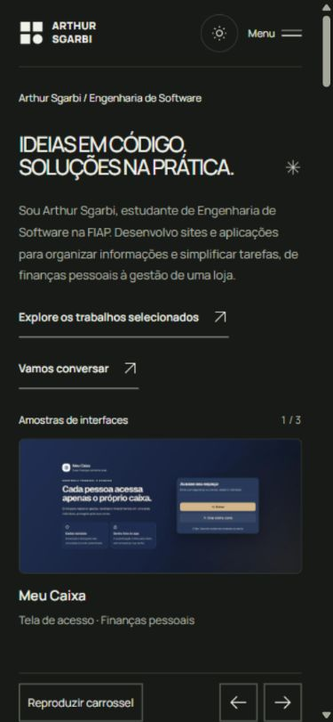

# Melhorias do portfólio — revisão de 29/10/2026

Implementação e validação local concluídas em 30/10/2026. Base da revisão: relatório `auditoria-2026-10-29/REVISAO-COMPLETA.md`, no diretório pai do repositório. Identidade preservada: Manrope, neutros, verde e títulos editoriais.

## Correções e decisões

| Área | Resultado |
| --- | --- |
| SYNC Mobile | A ação agora é **Abrir demonstração**, apontando para `https://sync-mobile.vercel.app/demo`. O destino abriu no navegador com o título SYNC Mobile e aviso de dados fictícios. O acesso ao código foi preservado. |
| Contraste | `--on-accent` define texto escuro sobre verde em formulário, login, ações e filtros. Erros e bordas têm tokens específicos por tema. Índices dos estudos usam `--accent-text`. |
| Carrossel | Uma captura integral por vez, legenda estável, pausa explícita salva na sessão, anterior/próximo e setas. Navegação manual pausa a reprodução; foco, aba oculta e movimento reduzido suspendem o avanço automático. |
| Cabeçalho móvel | Corrigidos cascata, espaçamento e dimensionamento em 320 px. Contato está no menu. A correção não usa ocultação horizontal do documento. |
| Prévia | A imagem indica **Abrir prévia**, enquanto **Ver estudo** abre a página completa. O fechamento do modal fica visível durante a rolagem. Foco inicial, ciclo de Tab, Escape e retorno de foco foram preservados. |
| Estados de projetos | Mensagens diferentes para seleção vazia, ausência de repositórios e falha na consulta. Nova tentativa continua disponível. |
| Contato | Novo preenchimento limpa a confirmação anterior. Falha preserva os campos; envio bloqueia repetição e sucesso limpa os dados. E-mail e LinkedIn fornecidos pelo proprietário foram adicionados, junto aos detalhes de uso dos dados. |
| Mensagens no painel | Filtros Visualizadas e Aguardando resposta; desarquivamento direto; link para responder no aplicativo de e-mail. Marcar como respondida apenas altera o estado da caixa. |
| Notificações | Mensagem persistida e notificação opcional são tratadas separadamente. O painel distingue serviço ausente, falha, aceitação pelo provedor e falta de confirmação. Não promete reenvio automático nem entrega na caixa do destinatário. Diagnóstico interno não é exposto pela API. |
| Destaques | A seleção e a ordem do painel continuam controlando a seção Projetos. A interface informa que o carrossel superior é uma seleção editorial independente. Somente os quatro estudos aparecem como opções. |
| Conteúdo | Apresentação centrada em Arthur, FIAP e desenvolvimento de software. Nomes editoriais separados dos identificadores GitHub. Operação manual do SYNC Mobile explícita, sem promessas comerciais ou resultados inventados. Rótulos de uso geral padronizados para painel e página inicial. |
| Estudos curtos | Mantidas apenas Sobre o projeto e O desafio, com contexto, problema, decisão/implementação, evidência e limitações. Contribuição individual em preparação, duração sem comprovação omitida. Retorno aos projetos e contato ao final. |
| Evidências dos projetos | A primeira captura real disponível substitui a composição como imagem principal do estudo. Meu Caixa continua identificado como tela de acesso; AETHER como portal de uma proposta acadêmica; SYNC como demo fictícia. |
| Processo e Diário | Abertura estável por clique, toque e teclado. Movimento do mouse não troca o conteúdo. O Diário descreve decisões observáveis, sem inventar responsabilidade individual ou relato pessoal de aprendizado. |
| Rodapé | Administração reduzida a um link discreto. Nome acessível de Mantenha a curiosidade acompanha o texto visível. |
| Login | Foco no título, mostrar/ocultar senha e orientação de recuperação pela conta do proprietário. Sem cadastro público novo. |
| Compartilhamento | Título e descrição com nome/formação, Open Graph, Twitter Card e imagem tipográfica 1200 × 630. Validação dos rastreadores em produção permanece pendente. |
| Manutenção | Tokens e decisões registrados em `DESIGN.md`. Estilos comprovadamente abandonados do antigo carrossel, composição inicial e bloco administrativo foram removidos. Componentes de estudos longos/galeria e seus dados históricos permanecem reutilizáveis, com testes; não foram restaurados às páginas públicas. |

## Desempenho das imagens

As três imagens originais da apresentação somavam **2.605.777 bytes**. As três versões WebP de 1600 px somam **184.188 bytes**, redução de **92,9%** no tamanho desses arquivos. As versões de 1280 px somam 137.728 bytes; as de 640 px, 50.096 bytes.

O navegador escolhe uma versão por `srcset`/`sizes`; não soma todas as variantes para exibir uma imagem. O primeiro slide recebe prioridade alta e os demais carregamento adiado. Os originais foram preservados. `scripts/prepare-hero-images.mjs` reproduz os arquivos com uma instalação de Sharp disponível, sem acrescentar dependência ao projeto. Essa medição é de arquivos, não uma medição de LCP ou da transferência total da página.

## Validação no navegador

Foram verificadas **80 combinações de página, tamanho e tema**: página inicial, formulário isolado, login, painel e os quatro estudos, em **320 × 740, 390 × 844, 768 × 1024, 1024 × 768 e 1440 × 900**, nos temas claro e escuro. As medições de largura não indicaram transbordamento horizontal. Capturas foram salvas para a página inicial em todos os tamanhos e para as demais páginas nos extremos de 320 e 1440 px, nos dois temas. A inspeção visual e os fluxos abaixo complementam essas medições; não equivalem a testar todos os estados em cada combinação.

| Fluxo | Evidência observada |
| --- | --- |
| Menu em 320 px | Contato visível; Escape fecha e devolve foco ao acionador. Documento com largura útil e de rolagem de 305 px. |
| Modal em 320 px | Fechar recebeu foco inicial; Shift+Tab/Tab circularam; botão permaneceu a 22 px do topo após rolar o conteúdo; Escape fechou e devolveu foco à prévia de origem. Sem transbordamento interno. |
| Carrossel | Próxima interface exibiu SYNC Mobile e a legenda completa. Reprodução ficou pausada após sair do controle e após recarregar a página. |
| Acordeões | Processo e Diário abriram com Enter; o conteúdo permaneceu expandido para leitura. |
| Projetos | Quatro rotas com imagem carregada e exatamente as duas seções previstas. Retorno ao catálogo funcionou. Estados vazio e sem seleção distinguiram suas causas. Falha de API foi recuperada usando Tentar novamente. |
| Contato simulado | Envio vazio apresentou quatro erros e foco em Nome. Enviando… ficou desabilitado; sucesso limpou os campos; nova digitação removeu a confirmação; falha preservou os valores. |
| Login simulado | Senha inválida apresentou erro, sem entrar; alternância mostrou/ocultou a senha fictícia; acesso válido abriu o painel. |
| Painel simulado | Mensagem marcada como visualizada apareceu em Visualizadas e Aguardando resposta; arquivamento, desarquivamento e marcação como respondida funcionaram. Seleção e reordenação salvas apareceram na página inicial simulada na mesma ordem. Saída retornou ao login. |
| Proteção local real | Acesso direto a `/dashboard` sem sessão redirecionou a `/login`. Nenhuma credencial real foi utilizada. |
| Página inexistente | Título e foco na mensagem de página inexistente; link retornou aos projetos. |
| SYNC público | Demonstração abriu com título e conteúdo de exemplo. Inspeção somente leitura, sem operar dados administrativos. |

As páginas em `src/test/browser/` simulam serviços e autenticação para evitar mensagens reais e alterações no banco. Elas não entram no build público. A gravação demonstrada no navegador vale para o estado simulado; persistência em banco real, RLS e entrega de e-mail não foram revalidadas neste trabalho.

### Contraste calculado

Valores calculados a partir dos tokens aplicados; formulário e login também tiveram as cores computadas conferidas no navegador.

| Par de cores | Claro | Escuro |
| --- | ---: | ---: |
| Texto sobre verde (`#171b12` / `#d6eb78`) | 13,32:1 | 13,32:1 |
| Erro sobre superfície principal | 7,29:1 | 10,34:1 |
| Borda de campo sobre superfície principal | 3,78:1 | 5,32:1 |
| Texto de destaque sobre superfície principal | 5,76:1 | 13,39:1 |

`DESIGN.md` foi conferido com a especificação local da skill design-review. A CLI `designmd` não estava instalada; não se afirma execução do lint dessa ferramenta.

## Testes e build

- **132 testes passaram em 12 arquivos**, na execução final após a revisão dos textos. Cobrem API GitHub, apresentação, carrossel, navegação, estudos, contato, autenticação/painel e contratos de backend com serviços simulados.
- Movimento reduzido, pausa manual, persistência da pausa e interrupção por foco estão cobertos nos testes do carrossel. Não houve alteração da preferência do sistema operacional para testar essa condição no navegador.
- **Build aprovado** com Vite; nenhuma dependência nova. Geração final em 3,64 s neste ambiente, sem usar esse número como resultado de desempenho do site.
- **`git diff --check` aprovado**. Avisos de normalização LF/CRLF do Windows não são erros de whitespace.
- Logs: [testes](melhorias-2026-10-29/testes.txt) e [build](melhorias-2026-10-29/build.txt). [Medições de login/painel](melhorias-2026-10-29/cp6-admin-measurements.json).

## Evidências visuais

| Evidência | Arquivo |
| --- | --- |
| Página inicial desktop, tema claro | [Captura](melhorias-2026-10-29/cp6-home-1440-light.jpg) |
| Menu em 320 px | [Captura](melhorias-2026-10-29/cp6-menu-320.jpg) |
| Fechamento do modal após rolar | [Captura](melhorias-2026-10-29/cp6-modal-320-rolado.jpg) |
| Erros no contato escuro | [Captura](melhorias-2026-10-29/cp6-contato-erros-390-dark.jpg) |
| Sucesso de envio simulado | [Captura](melhorias-2026-10-29/cp6-contato-sucesso-390-dark.jpg) |
| Falha com campos preservados | [Captura](melhorias-2026-10-29/cp6-contato-falha-390-dark.jpg) |
| Login escuro em 320 px | [Captura](melhorias-2026-10-29/cp6-login-320-dark.jpg) |
| Painel em 320 px | [Captura](melhorias-2026-10-29/cp6-dashboard-320-dark.jpg) |
| Painel desktop claro | [Captura](melhorias-2026-10-29/cp6-dashboard-1440-light.jpg) |
| Estudo Meu Caixa | [Captura](melhorias-2026-10-29/cp6-meu-caixa-1440-light.jpg) |
| Estudo SYNC em celular | [Captura](melhorias-2026-10-29/cp6-site-projeto-shopee-320-dark.jpg) |
| Estudo AETHER | [Captura](melhorias-2026-10-29/cp6-AETHER-front-end-1440-dark.jpg) |
| Estudo Memórias a dois | [Captura](melhorias-2026-10-29/cp6-anninha-site-novo-1440-light.jpg) |
| Destino público funcional do SYNC | [Captura](melhorias-2026-10-29/cp6-sync-demo-verificada.jpg) |

As capturas com faixa de verificação usam metadados e dados simulados, incluindo datas, linguagem de fixtures e identidades `example.invalid`. Esses valores não constituem fatos sobre os projetos ou contatos reais.

## Pendências e limites

1. **Informações do proprietário:** contribuição individual e divisão de responsabilidades nos quatro projetos, especialmente AETHER. Durações, resultados e relatos de processo só entram após confirmação. E-mail e LinkedIn foram confirmados; prazo de resposta não foi informado e não foi prometido.
2. **Evidências adicionais:** tela financeira autenticada do Meu Caixa com dados fictícios e capturas móveis dos projetos de origem. O portfólio aproveita o material existente e deixa seus limites explícitos; não fabrica novas telas.
3. **Publicação:** confirmar a origem pública definitiva, usar URL absoluta da imagem de compartilhamento e verificar prévias por rota com os rastreadores. A SPA atual entrega HTML compartilhado; metadados atualizados por JavaScript não garantem leitura por robôs sociais. Não houve deploy, push nem commit.
4. **Serviços externos:** esta alteração não comprova persistência em Supabase de produção, envio/entrega Resend, HTTPS/Secure, expiração natural de sessão ou autorização entre contas reais. Nenhuma mensagem real foi enviada e nenhum destaque real foi alterado.
5. **Acessibilidade e desempenho:** sem teste com leitor de tela real, aparelho físico, Safari/Firefox, Lighthouse ou rede móvel controlada. A validação local e os contrastes corrigidos não equivalem a certificação completa de acessibilidade.

Não há bloqueio para revisar e usar as melhorias locais. As pendências acima delimitam informações e verificações externas ainda necessárias.
